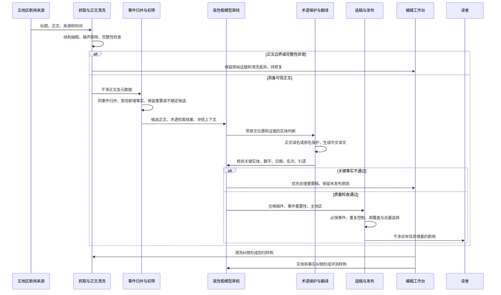

# 历史设计参考（方案建议，不覆盖spec用户要求）

## 1 新闻抓取和翻译

### 1.1 已确认的期望与范围

| 编号 | 用户期望 | 本次明确的含义 |
|---|---|---|
| N-01 | 翻译更加准确，额外接入高性能大模型判断和保护专有名词 | 增加上下文理解能力，降低普通词误认、真实专名漏认及错译；已有术语库和保护机制可继续复用 |
| N-02 | 正文不再被广告、原网站框架等内容污染 | 前期局部修复不能视为整个问题关闭；新文章质量和已有脏文章分别处理 |
| N-03 | 新闻数量可以更少，但重要新闻要保留 | 优先提高有效信息量和重要事件覆盖；不能仅按总条数下降判断成功 |
| N-04 | 各地区新闻源和新闻数量均衡发展 | **先覆盖日、港、英、法、美五地区；按周保障优质新闻覆盖，重大事件允许临时倾斜** |

N-04 的五地区范围、按周衡量和重大事件例外，已由用户在本轮明确选择。每日完全等量、立即扩展到赛事九地区均不作为本模块目标。

面向读者的目标体验：打开统一新闻流，能了解五地区值得关注的变化；同一消息不反复刷屏；进入详情后读到完整、干净的正文，马名、人名、赛事名和关键事实可靠。面向编辑的目标体验：知道重要新闻有没有漏掉、某地区为什么少稿，以及哪些稿件因清洗或翻译问题需要处理。

### 1.2 三层现状与 Gap

代码基线为 `fc1eed938beb8b431e0d4b37953f7599a40a72ce`。完整产品基线见[能力清单](../../reports/2026-10-02-current-capabilities.md)，历史需求见[待修事项对照](../../reports/2026-10-02-backlog-evidence-reconciliation.md)。下面严格区分代码能力、用户反馈和已验证运行结果。

| 能力 | 当前理论状况 | 当前实际状况与证据边界 | 未来期望 | 主要 Gap |
|---|---|---|---|---|
| 专名识别与保护 | 词条/别名检索、按出现位置的上下文规则、英文普通词/不确定/马名分类、日文规则、占位替换与恢复均存在；模型负责翻译，但实体判定主链未见独立高性能模型审校 | 用户反馈硬规则准确率不高；旧线程有普通词被大量误认案例。已有修复与模式开关，但本轮没有当前标注集准确率或生产模式证据。页面保留原文名本身不能判为误译 | 上下文识别发现真实实体，按正式译名或原名保护，译后验证身份和事实一致 | 缺少模型语境裁决、独立漏检发现、证据校验及持续评测闭环 |
| 正文质量 | 按来源选择正文容器，删除 DOM 噪声、推广段落与链接；已有清洗元数据、原始 HTML 和历史重处理工具 | 用户反馈仍有污染。19:03 复访旧样例 9623 未再命中指定污染词，但它只是一个成功样例，不能否定当前反馈。没有全来源近期污染率与误删率 | 广告、导航、弹窗不进入译文；正文段落、引语、表格和图片说明不被误删 | 缺少跨来源持续质量检测、模板变化发现、段落级审查和完整性验收 |
| 少而重要 | 规则评分、门禁、来源榜单、去重、同赛事曝光控制、地区窗口和配额存在 | 用户反馈数量与价值不匹配。当前首页可见多条日常马匹动向；仅凭标题不能确定每条低价值，也没有近期重要事件漏报统计 | 按独立事件及新增事实选稿，压缩重复和低信息量稿，保护重大更新 | 当前更偏单篇和来源信号，缺少完整的重要事件清单、跨来源同事件选择与漏报对账 |
| 五地区均衡 | 已有主地区/相关地区归属、五地区生产窗口、候选账本、配额、来源退避和零产出原因 | 用户反馈日本/JRA 相关新闻长期占优；22:25 重新加载首页仍见多条日本马匹及赛事情节。公开页隐藏来源，无法据此精确统计 JRA 官方源或每地区占比 | 五地区各有稳定有效来源；周维度有优质事件覆盖；重大事件可临时倾斜 | 缺少周维度的供给与曝光调节；其他地区漏采、翻译失败、误归属、待审积压和未选中需分别归因 |

本轮最新首页观察见 [news-design-home-observation.json](../../reports/2026-10-02-capability-evidence/news-design-home-observation.json)，时间为 2026-10-02 22:25:56 北京时间。此样本不等于一周分地区统计，也不能证明生产运行的代码、配置全部与本地一致。

### 1.3 当前代码中与目标直接相关的机制

| 机制 | 已核对的代码事实 | 对目标的影响 |
|---|---|---|
| 专名置信判断 | `classify_english_horse_occurrence` 依据规则、局部上下文和结构化证据返回分类；保护按 occurrence 位置执行 | 已有可复用的实体结构和保护执行层。当前 `confidence` 数值来自规则，不能作为实测准确率 |
| 来源加分 | `score_article_for_automation` 对 `source_site == jra` 给 15 分，其他来源 10 分 | JRA 官方源有固定倾斜；这是代码事实，实际贡献需按生产样本计算 |
| 高价值来源兜底 | 默认 `HIGH_VALUE_SOURCE_RULES` 含 `netkeiba:access,netkeiba:attention`；命中时在硬规则通过后把分数抬到自动审核阈值 | 日本站内榜单热度可能直接获得选稿优势；热度需要与面向本站用户的重要性分开评估 |
| 非日本政策分支 | 非日本新闻还会检查多地区自动发布策略是否允许 | 可能增加其他地区阻断，但是否构成当前主要瓶颈取决于真实配置与候选原因 |
| 低分补量 | `select_publish_candidates` 有地区窗口最少量和 `soft_fill`；默认最低补量分 45、常规自动阈值 75，补量稿禁自动 QQ | 与“宁可少发，也保留重要内容”的目标存在需要重审的策略差异；本轮未核验生产配置值 |
| 同赛事曝光 | 已有赛事身份、重复分类和双槽曝光机制 | 可以复用；不能把它等同于所有新闻事件，包括退役、任命、政策等，均已做跨来源去重 |
| 来源内清洗 | `clean_international_article_body` 使用通用 DOM 规则和 TDN、HRN、Sporting Life、Sponichi 等专用规则；部分适配器允许宽容器回退 | 修复单来源可见噪声有用，但非空正文或 `status=ok` 不代表已验证无污染、无误删 |

代码入口：[terms.py](../../../server/stable/services/terms.py)、[translation.py](../../../server/stable/services/translation.py)、[automation.py](../../../server/stable/services/automation.py)、[publishing_windows.py](../../../server/stable/services/publishing_windows.py)、[settings.py](../../../server/app/settings.py)、[article_content.py](../../../server/stable/services/article_content.py)、[international.py](../../../server/stable/adapters/international.py)、[race_news_exposure.py](../../../server/stable/services/race_news_exposure.py)。

### 1.4 建议的整体链路

这是未来设计，虚拟参与者表示逻辑职责，不要求建立新服务或替换 Django/Celery 主干。初筛只做明确重复和低价值过滤；标题不足、未知实体或重要性不确定时保留候选，避免尚未翻译就漏掉重要新闻。模型审校次数按风险设计，不要求每个节点都进行一次独立模型调用。

### 1.5 专有名词：增加模型判断，复用确定性保护

**建议采用“规则和词库召回 → 模型理解上下文 → 证据校验 → 占位保护 → 译后核验”。**

1. **实体范围**：马匹、骑师、练马师、马主/育马者、赛事、马场、组织等。模型既检查现有召回项，也扫描正文中可能漏掉的实体，不能被旧规则候选集合限制。
2. **输入**：可信正文、标题、原文语言、来源上下文、相关已审术语、可匹配的实体身份候选。来源国只作上下文，不直接决定每个同名实体身份。
3. **输出**：原文片段及段落/位置、实体类型、上下文证据、候选身份或无法确认、建议保护方式与冲突原因。程序检查片段确实存在，拒绝重叠、无效位置和模型生成的虚构词条。
4. **映射**：身份与已采纳译名一致时使用中文名；确定是专名但没有可信译名时保留原文；候选身份冲突时不能强行合并或直接写入正式词库。按模块 3 的明确约束，马名只允许收录可核验来源已经使用的译名，模型不得自行翻译，也不得把自行创造的马名包装成候选；有出处的新发现译名才可进入采纳链路。其他实体的命名政策另行定义。
5. **按出现位置保护**：同一个英文词在一段里是马名、另一段里是普通词时分别处理，避免全局替换。将经过校验的决定交给现有占位保护与恢复执行。
6. **译后核验**：除专名外，检查日期、奖金、距离、名次、数量、否定、计划/已发生、伤情和引语归属。名称拼写正确不能代表整句事实正确。高风险内容或不一致进入重点复核。
7. **失败行为**：模型超时或意见冲突不伪装为通过；重要稿进入优先待审。是否允许某类低风险稿使用已有翻译通道，需先由评测证明该降级路径安全，并保留使用记录。

例子：`Campaign` 出现在“开展宣传活动”中应正常翻译；出现在某马参加某场比赛的语境中才作为实体处理。同名的 `The Jockey Club` 需要结合文章主体与组织证据判别，不能仅靠来源语言或一个全局译名。

高性能模型在这里承担识别和审校职责。翻译 provider 可以先复用，之后通过同一评测集比较“原翻译模型 + 强审校”与“强模型直接翻译 + 核验”。后续模块 8 已明确 GPT-6 API 为复杂任务的目标方向；具体模型 ID、调用参数和任务路由仍需评测，不将接入模型本身视为准确率提升的证据。

复用 `ArticleEntityResolution`、术语与别名、占位恢复、`TranslationRun`；增加的逻辑产物为实体判定和事实核验记录。先验证是否可放入现有运行记录或元数据，实施设计再决定迁移，避免提前承诺新增表。

### 1.6 正文质量：清洗和完整性同时验收

建议采用三层检查：

| 层次 | 做什么 | 避免的问题 |
|---|---|---|
| 来源结构层 | 正文容器、分页、表格、图片说明及嵌入组件分别处理；记录来源模板和解析版本 | 整个 `main` 或推荐区被当成正文，或多页文章只取第一页 |
| 内容区块层 | 将区块分类为正文、导航、广告、推荐、弹窗、版权尾注、未知；明确噪声剔除，疑似区块可用模型复核 | 只查几个关键词而漏掉新样式；误删包含赞助商名的真实新闻 |
| 发布核验层 | 检查开头/结尾、段落连贯性、显著截断、关键数字和引语保留情况；不把“文本非空”当成成功 | 洁净度提高但正文丢失，或者中文稿仍使用旧脏译文 |

模型复核输出区块编号与原因，由程序执行可追溯的剔除；不要求模型自由重写正文来“清理广告”。保留原始 HTML、选取区域、删除区块、抽取文本版本和翻译输入版本，方便指出错误发生在哪一层。模型只能处理文章数据，不执行其中出现的指令。

来源模板变化时，从解析异常、正文长度/区块比例变化、抽样结果发现；降低异常来源进入自动发布的资格，保留重要稿待处理。其他来源按自身状态继续运行。

**已有脏文章另设修复清单**：先识别仍公开的污染稿，区分原文已干净但译文未更新、原文仍污染、人工编辑稿等情况，再决定清洗、重翻译或人工处理。修复文章内容与再次分发分别记录，不把历史清洗视为新新闻发布。现有历史重处理工具可复用，具体生产动作按根 [AGENTS.md](../../../AGENTS.md) 办理。

### 1.7 少发新闻：按事件和新增事实选择

建议把“重要性”“译文质量”“来源可信度”“来源热度”分开记录，避免一个总分掩盖原因。

| 建议层级 | 例子 | 发布行为 |
|---|---|---|
| 必保重要更新 | 重点赛事正式结果或更正；退赛、延期、关键参赛变化；重要马匹退役、重大伤病；对赛马活动有显著影响的规则公告 | 质量合格后优先处理，使用预留容量；暂时不能发时有原因和待处理责任，不静默丢弃 |
| 优选报道 | 有新增事实的赛前分析、重点马匹动向、重要行业报道 | 与同事件稿比较信息增量、可信度和地区覆盖，再进入日常容量 |
| 不单独发布或留候选 | 同源榜单重复、无新增事实的日常动态、重复转载、低信息量花絮 | 不为凑窗口条数发布；有实质新进展时重新评估 |

这套分类是建议，最终“哪些赛事、马匹、政策属于重要”需要以具体正反例校准。不能只用 G1 标签、词条是否已收录、点击榜位置或来源名定义重要性，也不能因为实体缺中文名而自动降为低价值。

同事件处理建议：选一篇最完整、可信、清洗合格的稿件作为主稿；后续出现赛果更正、退赛等新增事实时允许更新报道。赛事之外的退役、任命、伤病、行业公告也需可归并，不能只依赖 `RaceEvent`。优先复用现有赛事曝光与去重；是否需要一般新闻事件对象待实施设计。

本模块的“事件归并与选稿”不要求立即生成多篇综合文章。多篇生成可以留在长线内容能力中，避免将减少重复发布与生成式汇编绑定。

建议取消默认低阈值补量思路：没有合格新闻就少发。抓取候选量、进入强模型的量和最终发布量分别设预算；不能通过全面降低抓取频率来减少发布，否则可能同时降低重要新闻召回。

### 1.8 五地区均衡：同时治理供给和选稿

采用用户确认的周维度政策，建议以滚动 7 天监测缺口，并形成固定周报。五地区使用相同质量门槛，覆盖目标和软上限先用历史样本模拟，再确定数值。

**供给端**：每个地区建立来源清单，分别记录官方公告、综合媒体、赛事/行业媒体的有效覆盖、可用性、新鲜度、污染率和独立事件贡献。一个地区有更多来源 URL 不代表更强覆盖；多个转载同一稿的来源不能充当独立供给。全球综合来源按新闻主体归属到相应地区，不能全部按媒体总部所在地统计。

**处理端**：逐地区查看“发现候选 → 可信正文 → 去重后事件 → 实体/翻译通过 → 可发布 → 选中 → 网页发布”。例如法国少稿可能来自漏采、时间识别、误归属、翻译失败、词条误报或窗口配额，必须在对应环节处理；不能只提高法国配额后仍无稿可选。

**选稿端**：

1. 所有地区的重要事件先获得处理机会，质量门槛不变。
2. 对普通合格稿按价值、周覆盖缺口、重复程度选择；日常高产地区设置软上限，防止占满候选处理和首页曝光。
3. 来源信任度参与核验与排序，但建议移除“某个日本榜单来源就自动抬到发布阈值”的特殊保底，改用可跨地区评测的价值规则。
4. 某地区缺少合格内容时保留缺口及原因，不以低质量稿凑数；空余容量可给其他地区高价值内容，但仍记录未达覆盖的地区。
5. 重大赛事或突发事件允许暂时倾斜，记录事件、有效时间和例外原因；事件结束后恢复普通选择政策，不永久提高某地区权重。

**计数与展示**：同一事件多来源只计一个事件；发布总条数按实际文章去重。每篇有主地区及相关地区，主地区用于分配记账，相关地区另行反映交叉覆盖，避免一篇文章把多地配额同时“填满”。例如日本马赴法国比赛，应按报道主体判断主地区，不能只因出现日本马名就算日本新闻。

公开新闻流继续统一。均衡在来源、处理和选稿环节完成，不以恢复地区 Tab 作为前提。还需分开观察首页实际曝光和发布量，防止后台看似均衡而热门榜/头条长期只展示同一区域；人工指定头条的覆盖与有效期应能解释。

QQ 的数量、时效和通知策略属于后续分发模块；这里保留质量与事件标签作为输入，不自动把网页预算等同于群推送预算。

### 1.9 评测与验收建议

先取近期连续 14 天的五地区生产样本，加入历史故障用例和干净对照，冻结人工标注，再比较当前规则与新方案。自然分布样本用于整体体验，按地区/语言/困难类型的分层样本防止日本大量样本掩盖其他地区问题；调试样本与最终验收集分离。

| 维度 | 指标与分母 | 建议验收方法 |
|---|---|---|
| 专名识别 | 正确实体 / 所有判定实体；正确召回实体 / 人工标注实体；身份和译名对应正确率 | 按地区、语言、实体类型报告；普通词、同名实体、未登录词分别测试；模型自报 confidence 不当准确率 |
| 翻译事实 | 每篇关键事实错误、遗漏、无依据新增；人工实际修改量 | 关键实体、数字、日期、名次、否定与引语归属固定回归零错误；另报告独立样本通过率 |
| 正文清洗 | 污染文章率、噪声区块残留率、有效正文保留率 | 已知广告/框架样例和干净对照同时通过；不能以正文更短作为成功标准 |
| 少而重要 | 每日/每周发布条数、独立事件数、重复率、重要事件召回与处理延迟 | 在明确重要事件清单覆盖不下降前提下减少重复和低增量稿；未通过质量检查的重要稿计为待处理缺口，不能当已覆盖 |
| 地区均衡 | 各区有效候选、独立事件、发布和曝光占比；重要事件覆盖率；缺口持续时间 | 按周对账，重大事件例外单列；看实际覆盖，不只看配置了同样的配额 |
| 运行成本 | 每篇合格稿成本、强模型调用量、P50/P95 延迟、重试与待审积压 | 超时、供应商故障、预算不足有明确结果；有限预算内重要稿优先，不能静默丢弃 |

数值上的发布总量、每区周目标、软上限、重要新闻时效和成本上限目前尚未确定；先形成 14 天基线与几组策略回放结果，再选可达到的门槛，不在没有分母的情况下承诺准确率或每日数量。

### 1.10 差距台账与建议拆分

| Gap ID | 类型 | 需要交付的结果 | 可复用部分 | 依赖 |
|---|---|---|---|---|
| NG-01 | 运行证据缺口 | 五地区近期漏斗、当前开关、来源可用性、发布和曝光基线 | 窗口、候选和运行记录、零产出原因 | 只读运行数据与标注样本 |
| NG-02 | 正文质量能力 | 区块证据、完整性检查、模板变化检测和历史污染分类清单 | 适配器、清洗、原始 HTML、历史重处理 | NG-01 样本；新规则先离线回放 |
| NG-03 | 专名判断能力 | 强模型语境识别、漏检发现、身份/片段校验 | 实体结构、词条/别名、占位保护 | NG-02 的可信输入；困难实体评测集 |
| NG-04 | 翻译质量能力 | 译后事实核验、有限重试、重要稿优先待审 | provider、TranslationRun、翻译恢复 | NG-03；事实标注与故障回放 |
| NG-05 | 选稿政策与实现 | 重要事件保护、跨来源同事件去重与新增事实判断、减少补量 | 现有评分、去重、赛事曝光、配额 | 重要性正反例；NG-01 基线 |
| NG-06 | 地区均衡政策与实现 | 五地区来源覆盖清单、周目标、软上限、重大事件例外、曝光对账 | 归属、生产窗口、候选账本 | NG-05；各地区真实供给与失败原因 |
| NG-07 | 编辑质量反馈 | 清洗差异、实体冲突、事实差异和零产出原因可处理，纠错进入评测集 | 现有后台和日志 | NG-02–NG-06；可与后续手机后台共同设计 |

推进顺序建议：先基线与样本，随后正文质量和专名审校，再接译后验证；事件价值与地区策略可先离线回放，待质量能力稳定后组合验收。模型评测可以使用已确认干净的样本提前开展，不需要等待所有历史正文修复完成。

### 1.11 已确定与待确定

**已确定**：四项用户目标；五地区；按周覆盖；重大事件允许倾斜；新闻可以少而重要。

**设计建议**：强模型负责上下文判定与审校，确定性保护继续执行；质量不足不补量；按事件新增事实选稿；周维度软均衡；区块清洗与正文完整性共同验收。

**后续待确定**：重要事件正反例及必要的重点名单；发布总量和每区周覆盖目标；允许的时效与成本；模型候选及评测结论；历史污染处理范围。它们影响最终工期和成本，尚不阻碍继续收集其他模块期望。

本文仅维护下一版本设计，不把建议改写为已实施能力，也不覆盖全局状态或既有生产决策。
