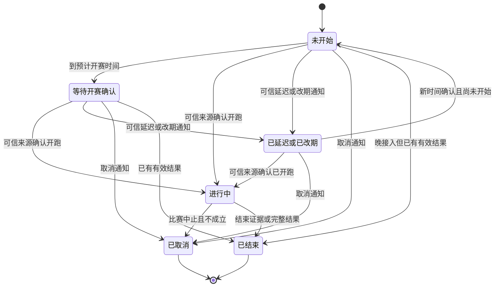
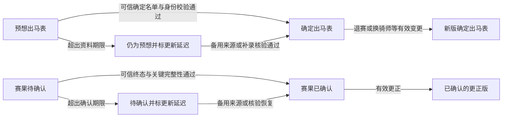
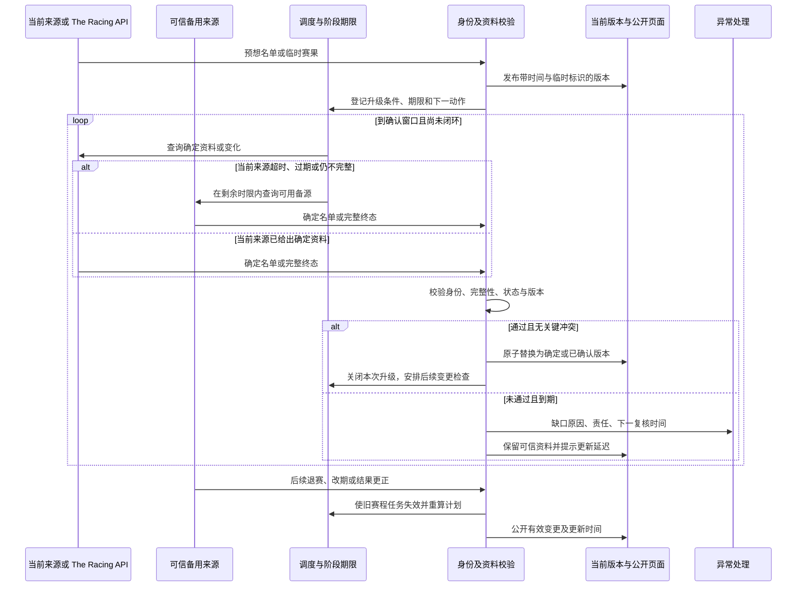

# 历史设计参考（方案建议，不覆盖spec用户要求）

## 2 赛事日历

### 2.1 用户明确的目标

| 编号 | 已确认的期望 | 设计含义 |
|---|---|---|
| R-01 | 赛前、赛中、赛后流转顺畅；信息错误率 <1%，流程卡顿率 <3% | 同时验收正确性和及时性；不能通过一直不发布数据来降低错误率，也不能靠强制改状态掩盖流程停滞 |
| R-02 | 充分利用可信第三方与已采购的 The Racing API，不死等官方 | “可确认的资料”与“官方站点直接提供”分开；按能力验证来源，已有合格第三方结果可以完成确认 |
| R-03 | 出马表区分预想/确定，赛果区分待确认/已确认 | 赛事进程和资料成熟度分别表达；预想与待确认有明确升级责任、期限和超时处置 |
| R-04 | 能识别赛事延迟、取消及马匹退赛 | 异常变化必须影响状态、名单、调度及页面，不能只在新闻里出现 |

范围按现有公开赛事日历的九地区设计：日本、中国香港、英国、爱尔兰、法国、美国、澳大利亚、德国、中东。模块 1 的五地区新闻范围不限制赛事模块。实时指标针对进入跟踪窗口的目标赛事，历史库存另列数据质量与修复指标，不混入大量历史记录稀释当前故障。

用户进一步确认：**信息错误率按场次关键资料计算；可信来源已经提供确定资料后，常规赛事 10 分钟内、重点赛事 5 分钟内完成“预想→确定、待确认→已确认”的公开替换。** 阶段截止时间和卡顿率的详细分母仍在下文作为设计建议。

### 2.2 当前理论、实际、期望与 Gap

| 能力 | 当前理论状况 | 当前实际证据 | 未来期望与 Gap |
|---|---|---|---|
| 进程流转 | `RaceEvent` 已有 scheduled/running/finished/postponed/cancelled；有时钟驱动转态、纳管、owner、租约、版本及公开控制 | 已有真实赛事闭环记录；10-02 的能力审查也看到过期仍待补赛事。覆盖恢复已交付部分成果，但没有可证明全站 <3% 的统计 | 全部目标赛事有责任、阶段期限和下一动作；延迟/取消优先于旧时钟，避免“任务成功但页面没变” |
| 来源利用 | 已支持 `licensed_api / official_operator / trusted_publisher`。默认来源等级为 300/200/100，API 高于官方；多来源绑定按能力存在 | 代码和既有交付已经使用第三方参考资料，不是纯官方系统；各地区能力、身份、路线和可用性仍不一致。本轮没有重新核验付费套餐与各端点实际覆盖 | 合格来源不因不是官方而只能永久停在待确认；来源选择须兼顾成熟度、新鲜度、完整性和健康，避免固定等级阻止及时更新 |
| 赛前资料 | 已有赛前候选、正式名单接管、持续刷新；默认 D−4 至 D−2 每 3 小时、D−1 每小时、当日每 10 分钟 | 京都大赏典样例有 18 行名单，但闸位缺失；兰秀锦标旧样例报名表与结果不一致 | 明确预想/确定两版与更新时间；成熟资料到达后限时原子替换；确定名单也能继续接收退赛和换骑师 |
| 赛后资料 | 已有 provisional/official/corrected 修订、公开版本与更正；T+3 开始尝试，后续退避 | 短途锦标有完整确认结果；女皇杯仍缺自由岛结果行，兰秀冠军摘要与名次待核实并存 | 将“已确认”建立在可信终态与关键完整性之上；页面冠军、名单、结果、统计读取一致版本；待确认不能无限期停留 |
| 异常变更 | 有延期/取消枚举、退赛状态解析、赛程 generation 和旧任务拒绝等基础 | 不能由“有枚举或局部适配器”证明九地区自然异常都已识别；本轮未取得延期/取消全链实测样例 | 来源变更发现、身份匹配、变更确认、重排任务、旧任务失效、公开提示形成完整链路 |
| 质量指标 | 有覆盖检查、候选、阻断原因、运行记录和下一步视图；统一决策方案已存在 | 当前记录能说明个案和某时点缺口，没有按本轮定义计算的错误率、卡顿率 | 建立不漏分母的事件/阶段账本，量化取数、处理和公开时延，按地区分别验收 |

当前代码证据：[生命周期决策](../../../server/stable/services/race_event_lifecycle.py)、[来源仲裁与轮询](../../../server/stable/services/race_data_sync_policy.py)、[结果投影](../../../server/stable/services/race_data_sync_results.py)、[赛前候选](../../../server/stable/services/race_pre_race.py)、[赛前刷新](../../../server/stable/services/race_pre_race_refresh.py)。

实际状况沿用 10-02 18:45–19:03 的浏览器观察与[旧案例复访](../../reports/2026-10-02-backlog-evidence-reconciliation.md)，以及[当前状态文档](../../current_state.md)中带时点的交付记录。本轮没有重跑生产验收，也没有把旧审查中的缺口数字当作现在仍未变化的数量。

### 2.3 来源政策：已确认不等于必须来自官方站点

建议将三个概念独立保存：

- **提供方**：The Racing API、官方运营方、可信媒体/第三方。
- **资料成熟度**：预测或临时信息、已公布的确定名单/最终结果、明确更正。
- **校验情况**：身份、时间、名单、状态、完整性及冲突校验是否通过。

确认规则建议：**一个已验证、具备对应能力的高可信来源给出确定名单或完整终态，且本站校验通过、没有未解决的关键冲突，就可以公开为“确定/已确认”。** 不强制每场等待官网，也不机械要求两个来源到齐。来源证据不足时用独立来源补证；存在关键冲突时主动交叉核对。同一底层数据的两个镜像不算独立佐证。

API 和第三方的“快速前几名”“预测排位”“尚未终结结果”仍只能进入相应临时层。已经付款是使用条件，不能代替对具体端点、地区、资料类型和最终状态含义的核验；应优先补齐这些能力映射，充分使用已有套餐，而不是默认另购或扩大调用。

来源选择改为按能力维护主用和备选：赛程、名单、闸位/骑师、开赛与结束、取消/改期、结果、更正可以来自不同来源。来源空响应、故障、过期或缺能力，不阻止其他合格来源推进；单一写入者与版本校验继续避免多来源争写。

需要特别处理当前固定等级的限制：在 `arbitrate_source_value` 中，低等级来源会先被拒绝，之后才比较时间。新设计应允许受控的“旧高等级资料失效 → 新鲜且已验证的备用来源接管”，并记录原因。不能改成“最后抓到的值永远覆盖”，也不能让新鲜预测稿覆盖有效的确定资料。

“已确认”仍可被以后明确更正；第三方确认后官网到达相同事实只追加佐证，不造成反复降级。确认不依赖赔率、奖金等非核心字段全部填满；关键名单/实际出赛者和名次/非完赛状态必须完整，缺少边缘字段就地显示缺失。

### 2.4 用户看到的状态与资料版本

| 维度 | 建议公开表达 | 关键规则 |
|---|---|---|
| 赛事进程 | 未开始、等待开赛确认、进行中、已结束、已延迟/已改期、已取消 | 进程表达现实发生了什么；到点触发查询，不独自证明已开跑或已结束 |
| 出马资料 | 预想出马表 / 确定出马表 | 预想来自有依据的报名或媒体预计名单；不是模型凭空猜马。确定名单可继续发生有证据的退赛、换骑师等更正 |
| 赛果资料 | 赛果待确认 / 赛果已确认 | 部分赛果必须标注不完整；已确认可由合格 API/第三方支持，不伪称官方直接结果 |
| 单马赛前状态 | 预计参赛、已确认参赛、退赛/取消出走、候补等 | 名单中消失只是疑点，不能单独证明退赛；明确状态或有证据的差异核验才变更 |
| 单马赛后状态 | 名次、并列、竞走中止/未完赛、失格等 | 无名次者仍保留，不把退赛等同完赛，不为占位伪造最后一名 |
| 资料健康 | 更新时间、更新延迟、资料冲突/待核验 | 作为辅助提示与运营责任，不混成赛事进程；超时不能自动升级为已确认 |

页面默认展示当前最可靠的完整版本，历史预想和旧版结果可在变更记录中查看，不需要同时平铺两张相近的大表。新确定资料到达后替换主展示，冠军卡、结果列表与相关统计使用同一生效版本；保留历史证据和纠错记录。

“已结束”和“已取消”结束正常赛程轮询；结束后的赛果确认、更正，以及有明确恢复通知的取消赛事，仍有独立处理入口。不能为了展示完整状态历史而补造未观察到的赛中过程。

超时节点是失败处置，不是正常终点；补齐后仍记入本次超时记录。已确认资料出现争议时保留最后可信版本并标注争议，只有明确撤销/更正证据才能变更，不因来源暂时不可用清空数据。

### 2.5 临时资料的期限与升级责任

必须有两种独立时钟：

1. **资料到达时钟**：可信来源首次提供可用确定资料的时间 → 本站公开新版本的时间。计时包含发现、排队、解析、验证和公开，不能从“任务终于开始”才算，也不能只保证写入数据库。
2. **赛事阶段时钟**：即使来源状态不明，也按赛程给出最晚应完成的阶段期限；到期必须标记缺口、切换来源和升级处理，防止“来源没给”成为无限等待理由。

资料替换的常规 10 分钟/重点 5 分钟已由用户确认；其他阶段分钟值与各地区来源开放窗口仍需校准。任何正式例外必须预先明确依据、范围与新的复核时间，不能在错过期限后追溯改指标。

| 场景 | 建议期限/触发点 | 超时行为 |
|---|---|---|
| 确定名单、赛时、退赛、赛果或更正已被可信来源公布 | 常规赛事 10 分钟内、重点赛事 5 分钟内完成本站公开；资料版本替换已确认，其他关键变更建议沿用此档位 | 在剩余时限内切换合格备用来源；仍未成功则记录超时、责任和下一动作 |
| 仍只有预想出马表 | 按地区/资料类型预设确定名单开放窗口；赛前 T−60 分钟预警，T−30 分钟仍无确定名单进入异常处理（建议） | 不把预测改标签冒充确定；主动补源、优先人工核验并公开更新时间 |
| 到预计赛时但没有开跑/结束信号 | 立即进入开赛核验窗口；超过所选更新时限仍无结论计为阶段缺口（建议） | 排查延迟、改期、取消；不按旧时刻直接认定进行中 |
| 正常赛事结束后仍待确认 | 以可信实际开跑时间为优先锚点，正常场次 T+30 分钟前完成确认（建议） | 主动查备用来源和缺行/身份冲突；仍不满足则保留待确认并标超时 |
| 已知有赛事审议、抗议或不可抗力 | 标明正在审议或其他已证实原因，按预设复核期限追踪 | 不伪造确定结果；正常确认时效中保留超时事实，另列赛事方原因及总体验影响 |
| 只有日期、没有可靠时刻 | 在该地区既定赛卡开放窗口内追踪；当地赛日结束仍缺资料按阶段截止处理 | 不猜造 00:00 或直接宣称完赛；无时刻不使其退出跟踪分母 |

这里的 T 使用可信的当前实际开跑时刻；实际时刻不可得时明确使用最后已确认的计划时刻作为调度锚点，不能宣称已实际开跑。出现可信延迟/改期后用新赛程建立新代次并重算未来期限；单纯任务失败、来源超时不能延后业务期限。

当前 D−1 每小时、当日每 10 分钟的轮询，不能保证从来源发布起算的 5/10 分钟端到端时效。需要在确定名单开放期和赛前赛后关键窗口提高优先级与频率，并给排队、解析及回退留余量。周期、请求配额、并发与 API 套餐须联合测算，不把旧轮询配置当新 SLA 已完成。

如果拿不到来源的精确发布时间，应保存“上次未见/首次发现”的区间，或用独立监测样本核定；计时不确定需显式报告，不能将首次入库时间当成来源真实发布时间以美化延迟。

### 2.6 延迟、取消、退赛的处理规则

| 变化 | 识别与确认 | 必须联动的动作 |
|---|---|---|
| 同日延迟 | API/可信来源明确状态或新的开跑时刻；新闻可提供有出处的变化线索 | 标延迟、保存原/新时间；取消旧代次任务，重排赛时及赛果任务；仍无新时间时进入有期限的复核 |
| 跨日改期 | 同一比赛身份下确认新日期/时间，区分改期和另一届次 | 保留同一赛事历史，更新日历归属与北京时间；重排名单核验、开赛及赛果计划，不能复制成重复赛事 |
| 比赛取消/中止不成立 | 可信来源有明确取消/abandoned 等业务含义，不根据“没有结果”推断 | 显示取消和原因；停止普通开赛/赛果等待，不补造赢家；保留既有名单和取消证据 |
| 某匹马退赛/不出赛 | 明确 scratched/withdrawn/non-runner 或受核验的状态变更 | 确定名单更新为退赛，保留记录；更新实际出赛集合；旧版名单不能把它恢复成参赛 |
| 名单中消失但无明确状态 | 比较版本、来源完整度和身份映射，必要时补证 | 标记差异待核实，不自动删马或断言退赛；作为关键数据疑点优先处理 |
| 换骑师/闸位修订 | 同一马匹/参赛身份的字段变更及版本证据 | 更新对应字段与更新时间，不创建重复 runner，不覆盖更晚的可信变更 |
| 未完赛/失格/并列 | 解析明确赛后状态与真实名次 | 每个实际出赛者都有结果或非完赛状态；并列保留真实名次，无名次者置于正常名次后 |
| 赛后更正 | 明确的更正证据，或冲突经核验得到结论 | 新版本替换当前结果；冠军、名次、履历统计同步使用新版，保留原版及更正说明 |

关键守恒不是“报名人数等于有名次人数”，而是：已核验参赛名单中的每匹马都有赛前状态；实际出赛者都有一个结果/非完赛结局；未出赛者有明确理由；未知者保留为缺口。退赛与未完赛不能混为一类，也不能直接丢行。

模块 1 识别到的退赛/延期新闻可以加速变化发现，但赛事资料仍沿本模块的来源与事实校验处理；单篇 AI 抽取不能凭空改变赛事状态。

### 2.7 多来源替换与异常时序示例

以下为设计示例，不代表已运行或已测得性能。

例如一场原定 14:30 的比赛，14:28 可信来源通知延至 14:45：14:30 的旧任务不能把它改为进行中，15:00 的旧 T+30 任务也不能把它误判结束。若高可信第三方先给出完整终态，本站可以据此确认赛果；无需继续等待官网才能升级。

### 2.8 两个质量目标的建议统计口径

用户给定阈值为严格 **<1% / <3%**。信息错误率按场次关键资料计算已确认；卡顿率详细分母、统计窗口和抽样方法仍为建议。不能引用旧故障计数直接计算。

**信息错误率：按场次关键资料验收，已确认。**

`信息错误率 = 审核范围中出现至少一项关键错误的赛事数 / 审核赛事数`

关键资料包括赛事身份、日期/时区/赛时、进程、名单及退赛、马匹身份、名次/并列/非完赛和冠军。每场按固定阶段快照及公开变更版本审查；错误短暂出现后修正也保留记录。少量错误不能被同场大量正确小字段稀释。赔率等边缘字段另报字段准确率。

有正确标识和来源依据的预想名单，后来因正常确认而变化，不自动算事实错误；无依据猜测、错标确定、已知变更后超时仍显示旧事实，应计入相应错误/过期问题。空缺不能当正确数据填充分母，其覆盖和超时另行计量。

**流程卡顿率：建议按应推进赛事验收。**

`流程卡顿率 = 至少一次错过阶段或更新期限的赛事数 / 在统计期内应完成推进的赛事数`

同场多个卡点在主指标中只计一场，另报阶段级次数与持续时间。分母包含未登记、无来源绑定、阻断、任务未执行、解析失败及已发现但未公开等实际目标；不能只统计成功进入流水线的赛事。外部来源延迟单列原因，仍反映在总体体验超时中，不默认从分母剔除。

建议使用滚动 28 天主指标，并每日观察；九地区分别报告数量与比率，防止日本大样本掩盖其他地区问题。跨期仍未闭环的赛事继续进入超时台账，不能因为比赛日期离开统计窗口而消失。历史资料质量单独抽查，不以大量历史已完成比赛稀释实时卡顿率。

同时报告样本量、覆盖率、数据缺失和误差范围。样本很少时即使 0 错误也不能宣布全站长期达标。上线前离线异常回放、跨来源演练与上线后的真实自然周期都需要证据；一个 200 页面、一条成功任务或某日队列为空均不能替代这两个指标。

### 2.9 必须覆盖的验收场景

1. API 先到、第三方后到；第三方先到、API 后到，均形成一个赛事、一套生效资料。
2. 第三方提供合格最终资料而官方不可用，仍能在期限内确认；前几名摘要不能冒充全场结果。
3. 预想名单已有内容，确定名单到达后仍会接管；此后退赛不删除历史行。
4. 主来源停更，备用来源按能力接管；迟到旧版本不能覆盖新资料。
5. 同日延迟、跨日改期、取消与旧开赛/T+30 任务并发，最终状态和任务代次一致。
6. DNF、失格、并列、未出赛、未知状态与缺行分别处理；自由岛历史案例作为固定回归样例。
7. 已确认后更正，冠军卡、名次、履历统计和页面版本一致；兰秀样例的内部不一致进入回归。
8. 来源冲突只阻断受影响资料的确认；其他独立有效能力仍推进，整场始终有下一动作。
9. 未登记赛事、身份歧义、权限到期、worker 停止、派发失败、队列积压均能发现并记入相应超时。
10. 跨时区、夏令时、日期未知/时间未知、赛日边界和取消后恢复都有明确解释与复核路径。

### 2.10 差距台账与既有方案衔接

| Gap ID | 需要交付的结果 | 当前可复用 | 主要差距 |
|---|---|---|---|
| RG-01 | 全公开目标、阶段期限及两项指标账本 | 覆盖检查、下一步视图、运行日志 | 尚未按本轮分母与期限形成可验收指标 |
| RG-02 | 九地区按资料能力的主备源和实际套餐覆盖 | TRA、可信第三方、官方适配器及多来源 binding | 不同地区验证与运行覆盖不齐；付费端点能力未统一映射 |
| RG-03 | 预想/确定、待确认/已确认统一读模型 | 候选、revision、publication、读门禁 | 公开成熟度与“官方”语义需统一；冠军/结果等必须同版本 |
| RG-04 | 有期限的自动升级、备用切换与恢复 | 轮询、检查点、lease、owner、generation | 无端到端升级 SLA；固定来源等级、慢轮询和退避可能导致卡住 |
| RG-05 | 延迟、改期、取消、退赛全链识别与重调度 | 异常枚举、状态解析、赛程代次及旧任务拒绝 | 局部能力未证明全地区自然场景覆盖，变化未必贯穿页面与统计 |
| RG-06 | 关键名单/结果完整性及更正一致性 | runner/participant、身份映射、结果修订 | 历史缺行、阶段语义混用、旧版本反向覆盖和公开内部不一致 |
| RG-07 | 跨来源与异常回放、自然周期验收 | fixtures、现有测试和覆盖产物 | 缺少对应 <1%/<3% 目标的一致验收集与生产统计 |

已有[统一决策方案](../race-event-unified-decision/spec.md)中“事实与时钟分开、完整跟踪责任、统一下一动作、单一写入者”与本次目标一致，可作为工程基础。新补充的是确认政策、用户可见的资料版本、替换时限、两项量化指标及异常业务验收；不能以旧方案存在就判断已完成，也不另造平行结果同步链。

该旧方案区分完整参考结果和正式结果；后续实施设计需要明确如何兼容到本次“合格第三方也可已确认”的口径，逐项迁移规则而非改标签冒充确认。历史发布记录保持原意，现行生产行为在正式实现与交付前不变。

建议先建立 RG-01 和来源能力基线，再统一 RG-03/04/05 的决策与页面合同，补 RG-06 缺陷并完成 RG-07。来源验证、指标设计和离线异常回放可以在各自边界内并行，最终工期由真实来源缺口与历史修复范围决定。

### 2.11 已确定与待确定

**已确定**：信息错误率 <1%，按场次关键资料计算；流程卡顿率 <3%；可信来源公布确定资料后，常规赛事 10 分钟内、重点赛事 5 分钟内完成临时资料替换；可信第三方与 The Racing API 应充分参与；识别延迟、取消和退赛。

**设计建议**：按应推进赛事统计卡顿；通过单个高可信来源的完整终态与关键校验可以确认，不要求官方站点到达；进程/资料成熟度/健康分离；双时钟、限时主备切换与原子版本替换。

**待确认或校准**：卡顿率详细分母与统计窗口；赛前 T−30 与正常赛后 T+30 等阶段截止时间；重点赛事范围；每地区已购端点能力、调用预算及来源确认规则。后两类先通过证据盘点，能由现有合同确定的内容不重复询问用户。
