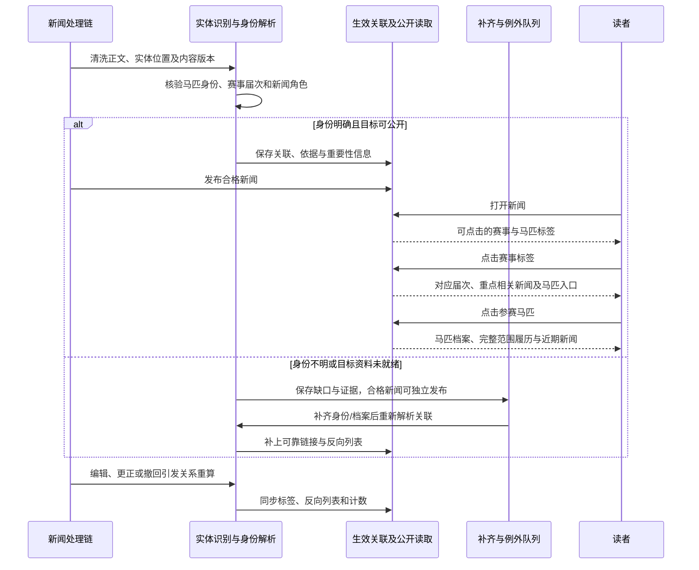
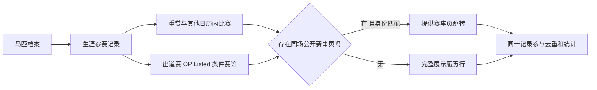

# 历史设计参考（方案建议，不覆盖spec用户要求）

## 4 QQ 推送与长期 API 服务

### 4.1 已确认目标与当前差距

用户明确短期可以下线 QQ 推送，因为没有用户使用；长期待内容稳定后，可以通过 API 对外提供服务。当前讨论属于版本规划，未执行 QQ 停服或生产配置修改。“没人用”为用户提供的业务判断，本轮没有独立核验群活跃或投递统计。

| 能力 | 当前理论状况 | 当前实际状况与边界 | 未来期望及 Gap |
|---|---|---|---|
| QQ 分发 | 有自动发布后推送、地区窗口、人工后台/API 推送、独立投递记录和重试，使用 OneBot | 本轮未进行外发测试，也未查生产开关；用户已明确该渠道近期价值低 | 短期退出产品流程和运维依赖；需覆盖全部发送路径，而不只隐藏按钮或关闭自动入口 |
| QQ 与网页解耦 | 已有网页发布状态与 QQ 投递记录；旧人工发送还会更新文章 `status` | 停 QQ 后网页、后台状态与监控是否完全不受影响尚未验收 | 网页发布成功以网页可见为准；停用渠道不应制造内容失败、永久待办或异常重试 |
| 对外 API | `/api/` 有文章、任务与术语读写接口，要求后台登录和 staff 权限 | 这些是后台接口，没有已开放开发者服务的证据 | 长期建立独立的内容读取合同；不能直接取消现有管理接口鉴权来开放服务 |

代码证据：[手动发送](../../../server/stable/services/pushing.py)、[自动投递](../../../server/stable/services/qq_auto_push.py)、[窗口调度](../../../server/stable/services/qq_windows.py)、[任务](../../../server/stable/tasks.py)、[管理 API](../../../server/stable/api_urls.py)、[后台视图](../../../server/stable/views.py)。

当前 `enqueue_qq_auto_push_for_article` 与自动文章任务会检查 `QQ_PUSH_ENABLED`；`article_push_api → enqueue_push_for_article → push_article_task → push_article_to_targets` 是独立手动链路，所查入口未统一检查该开关。已有投递任务又会按节流和失败状态自行重排，因此单关入队开关不能作为“已下线”的充分证据。

### 4.2 短期下线的建议交付边界

1. **停止产生和执行发送**：覆盖自动发布后触发、地区窗口、后台/API、Django Admin、旧排队及重试任务；发送执行端也检查渠道停用状态，防止陈旧任务绕过入口。执行停用时记录生效切点和在途任务结果，不把此前已发生发送算作停用后新发送。
2. **退出日常产品流程**：移除或明确禁用推送入口、目标配置快捷入口和 QQ 配额待办；旧接口返回清楚的停用结果，不返回“排队成功”后静默不送。历史记录保持可查询，不为停用渠道删除新闻或整批清空共享 Celery 队列。
3. **清理独占依赖**：停止 QQ 专属周期任务与健康探测；确认 OneBot 服务及配置没有其他使用方后再退出相应运行依赖。新闻、赛事、资料更新和必要的运营告警继续按各自链路工作。
4. **保留可解释状态**：遗留待投递任务按停用原因结束或封存，不伪装成发送成功；后台从内容质量和网页可见性判断完成。短期无需为保留旧推送代码开展大规模删表或历史迁移。

下线验收包括：手动、自动、重试和重启后的旧任务均不能新发 QQ；文章正常发布；后台不再提示必须推送；停用渠道不会形成无意义告警或积压。本轮没有执行这些生产动作。

### 4.3 长期 API 的建议形态

建议先提供**已公开内容的只读 API**，让其他网站、客户端或机器人按需消费新闻、赛事、马匹与它们之间的关系。QQ 可以由未来消费者自行接入，不要求 Umanews 同时恢复群发送服务。

初期合同应包括稳定实体 ID、可用字段、更新时间、资料确认状态、关联 ID、分页/增量游标、错误语义，以及更正和撤回的传播方式。增量消费者必须能得知内容已撤回或被更正，不能只取得新增记录后永远保留错误旧版。面向消费者的凭证、读取范围、限流与调用记录和现有后台管理权限分开。

对外字段范围、图片/全文/结构化资料的可提供范围、首批消费者需求、容量与服务时效需要在立项时确定。本轮不锁定收费模式、Webhook、SDK 或写入 API。网站内部可先复用一致的公开读取规则与稳定身份，不必为未来 API 提前建设完整开发者平台。

“内容稳定后”的进入条件建议使用前面模块的质量、时效和更正能力实测，而不是只看接口能否返回 200：新闻质量可持续验收，赛事达到已确认的 <1%/<3% 目标，马匹资料范围可解释，跨模块身份与链接可靠；统计窗口及长期 API 的正式范围另行确定。

| Gap ID | 交付结果 | 时间定位 |
|---|---|---|
| QG-01 | QQ 全路径停用、遗留任务终止和网页链路解耦 | 下一版本短期候选 |
| QG-02 | QQ 后台入口、专属运行依赖和监控退出验收 | 与 QG-01 同批交付 |
| QG-03 | 稳定公开内容 API 合同、消费者与服务验收 | 内容稳定后的长期方向，不作为下一版发布前置 |

## 6 模块间关系

### 6.1 已确认的用户目标

新闻自动识别赛事与马匹，提供可点击的实体标签/Tab；赛事聚合相关新闻，对赛果报告等重点新闻优先展示并可跳转；赛事中的马匹可进入对应档案；马匹档案展示生涯比赛和近期新闻，分别链接已有赛事页和新闻页。

**马匹生涯比赛范围大于赛事日历范围。** 出道赛、OP、Listed、条件赛等即使不在日历收录范围，也可以出现在履历中。用户要求的是“有对应赛事时可跳转”，没有要求为每条普通赛履历新建公开赛事页或扩大日历范围。

### 6.2 当前理论、实际、期望与 Gap

| 关系 | 当前理论状况 | 当前实际状况与边界 | 未来期望及 Gap |
|---|---|---|---|
| 新闻 → 赛事/马匹 | 有 `ArticleRaceLink`、`ArticleHorseLink`，区分自动、人工、候选与移除；公开页已有标签 | 本日实访新闻 → 拯救者可用；不是每篇应有关联的新闻都已有标签。赛事匹配主要依赖名称、日期窗口等规则 | 复用模块 1 的实体识别，确认具体身份与赛事届次，可靠自动挂接；不能只抽出普通字符串 |
| 赛事 → 新闻 | 已有赛前、赛后、相关分类与新闻卡片；只读已发布文章 | 本日抽查赛事未见分组；代码没有本轮要求的重点报道优先合同，不能以分组能力证明聚合已完整 | 自动持续聚合、明确总数和排序，赛果报告及重要变化优先，点击新闻详情 |
| 赛事 → 马匹 | 有 `HorseRaceLink`、参赛身份与来源信息；Runner/Result 保留马名 | 公开模板的名单、赛果、冠军和历年冠军马名主要为纯文本 | 按参赛身份解析到公开马匹档案，覆盖预想/确定名单、赛果等；不能靠显示名字临时拼链接 |
| 马匹 → 新闻 | 已聚合本马及最多两代后代的公开新闻，有限量与排序 | 拯救者档案回到相关新闻已实测 | 本马近期新闻作为明确主入口；后代新闻保留区别，去重并避免挤占本马信息 |
| 马匹 → 生涯比赛 | `HorseRaceRecord.event/result` 可为空，有独立赛事名、日期、等级、来源和身份键；枚举含新马、未胜利、OP、Listed 等 | 分页与部分履历跳转已实测；全生涯覆盖仍不完整，缺字段与统计矛盾见模块 3 | 普通赛也可收录，无赛事页保留完整履历行；后来建立关联不重复计数 |

代码证据：[关系与履历模型](../../../server/stable/models.py)、[赛事新闻匹配](../../../server/stable/services/race_events.py)、[马匹新闻匹配](../../../server/stable/services/horse_profiles.py)、[公开视图](../../../server/stable/views.py)、[新闻模板](../../../server/stable/templates/stable/public/detail.html)、[赛事模板](../../../server/stable/templates/stable/public/race_detail.html)、[马匹模板](../../../server/stable/templates/stable/public/horse_detail.html)。实际证据沿用本日[能力基线](../../reports/2026-10-02-current-capabilities.md)和[旧案例复访](../../reports/2026-10-02-backlog-evidence-reconciliation.md)，本节没有重新登录后台或核验全站覆盖率。

赛事规则匹配目前可将标题/摘要命中直接标记为 `AUTO`，正文命中多留候选；默认扫描在赛事前后 14 天且最多 500 篇。马匹按文章扫描复用实体解析，部分正文命中仍为候选；从档案扫描也有名称规则路径。日期范围、候选上限和多条入口意味着需要显式补历史与补漏，不能仅提高阈值就宣称全量自动关联。

### 6.3 关联基于实体和发生事实

建议统一复用已核验实体身份及来源证据，三类关联分别记录依据、角色、版本和人工修正，不要求合成一张万能关系表，也不引入新的图数据库。

1. **新闻—赛事**：区分每年复用的赛事系列和某年某日实际举办的一场比赛。结合年份、日期、马场、参赛者和原文语境匹配；提到去年冠军不能无条件挂到今年比赛。仅谈系列历史、无法定位届次时保留系列语义及待解析信息，不能任意选择最近一场。
2. **新闻—马匹**：识别原文中的真实马匹实体，再匹配稳定身份和多语言别名；一篇文章可关联多匹马、多个赛事。一般词不因恰好与马名相同就成为标签；主角与背景提及可以有不同排序权重。
3. **赛事—马匹**：以当场 runner/result/participant 身份为依据，名称只作展示。比赛名单里的每匹马独立解析；无中文名仍可链接原名档案。身份明确而尚无档案时进入模块 3 的优先最小档案流程，身份不明时保留文字并记录缺口，不生成错误跳转。
4. **生涯记录—赛事**：优先来源稳定比赛 ID 或经核验的比赛实例键；跨来源不能只用赛事名称和年份合并。同一普通赛以后取得 `RaceEvent` 关联时更新原记录，不另加一次出赛。

手工确认或移除的关联保留明确保护与原因。文章修改、改名、更正、撤回、实体合并和新档案公开都要触发受影响关联重算；已移除的错误关系不能下一次扫描又自动长回来。陈旧任务检查内容/关系版本，避免重新挂回旧关联。

### 6.4 三种页面的建议交互

**新闻页**：展示“相关赛事”“相关马匹”实体标签，名称适当简洁，赛事补年份或日期消歧。标签直接跳到对应公开页，手机能横向浏览或展开；同一实体去重。只有可靠且可公开的目标才提供链接，未知实体计入补齐队列。这里的标签承担导航，不等同于手工自由文本标签。

**赛事页**：相关新闻显示去重后的可见总数，可继续查看更多。建议按当前比赛阶段与业务影响排序：已完赛时优先结果报告及结果更正，赛前优先确定名单和重要退赛/延期/取消，普通前瞻、采访和背景信息随后。重大变更不能被旧结果报告永久压住；同等级内综合相关性、质量和新鲜度。人工可纠正重点选择，但常规排序应自动完成。

新闻分组与重要性是两个维度：赛后采访不自动等于赛果报告，标题含“赛果”也不必然是该届正式报告。优先卡片不能把新闻中的暂定结果包装成已确认赛果。新闻关联和排序复用模块 1 的内容理解与去重结果，不必重复进行多轮模型判断。

**马匹页**：主展示本马近期新闻和按日期排序的生涯比赛；后代新闻明确标注或分组，不混同本马。已有公开赛事页时履历名称可点击，无对应页时展示日期、名称、马场、等级、距离、名次和可得其他字段；不能因没有赛事链接就隐藏整行。分页、筛选和统计均不得隐式限制为日历里的重赏赛。

“相关新闻数”按当前合格公开文章的不同 ID 统计，与分页总数一致；撤回、隐藏、候选和被移除关联不计入。同一篇报道关联多匹马或多个赛事，在各目标页各显示一次。所有反向列表由相同生效关系读取，避免新闻页有标签、赛事页却找不到该新闻。

### 6.5 内容更新到双向导航的时序

关联任务允许独立重试，但需要监控从内容公开到关联可用的时延。不能为了等一个不确定标签无限阻塞本来合格的新闻，也不能把发布后一直缺标签视为正常完成。具体关联时限随范围与容量基线确定。

### 6.6 生涯履历与日历范围的关系

建议复用 `HorseRaceRecord` 的独立存储和可空赛事关联。新增履历不会自动扩展赛事日历，也不会让每场普通赛取得实时抓取任务。后来为某场建立页面，只补关联；如未来需要普通赛详情产品，再单独设计，当前不预建空赛事页。

### 6.7 验收、差距与范围衔接

| Gap ID | 交付结果 | 核心验收 |
|---|---|---|
| LG-01 | 新闻实体识别与赛事届次/马匹身份解析 | 同名异马、跨年赛事、正文多实体、背景提及、无中文名均正确处理 |
| LG-02 | 自动双向关联、变更传播与补漏 | 自动/人工发布、编辑、撤回、目标后来建档均能更新双向列表；旧错误不复活 |
| LG-03 | 新闻页实体标签/Tab | 可靠目标可点击、正确页、去重和移动端可用；未知目标明确留缺口 |
| LG-04 | 赛事相关新闻总数、重点排序与分页 | 本届赛果报告高优、重要更正/取消及时提升；总数与可见集合一致 |
| LG-05 | 名单、赛果及冠军区域的马匹跳转 | 以参赛身份链接，改名和退赛不串马，目标档案缺失进入近期补齐 |
| LG-06 | 全生涯履历与日历范围解耦 | 出道、OP、Listed 等保留；无赛事页仍可见；后续关联不重复计数 |
| LG-07 | 马匹近期新闻与跨页关系质量验收 | 本马和后代区分，去重、隐藏与撤回一致；公开链路全程可走通 |

固定回归流程至少包括：新闻 → 2026 年某场赛事 → 某匹参赛马 → 另一条已关联赛事履历 → 赛事新闻 → 新闻详情；再覆盖一条没有日历页的出道赛履历，证明该记录仍展示且计数正确。测试数据还需包含同名跨年赛事、同名不同马、取消/退赛、待确认赛果、中文改名、文章撤回和实体合并。

关联质量同时看准确率和召回率：不能通过不创建任何链接取得“零错误”。分别统计可识别实体的正确挂接、误挂、漏挂、无档案目标和发布后关联延迟；点通链接只证明导航可用，不证明目标身份正确。

本模块本轮确认的是导航与聚合。历史用户还要求新闻事实更新赛事详情，该要求继续保留在模块 2 的来源校验与版本更新链路；不能因一个新闻标签关联成功，就直接拿文章中的闸位、退赛或名次覆盖正式资料。

## 7 补充体验与尚未落地事项

### 7.1 证据和建议分开记录

用户允许补充线上表现偏差、已规划未落地及其他影响体验的事项。本节以本日[能力基线](../../reports/2026-10-02-current-capabilities.md)、[历史待办对照](../../reports/2026-10-02-backlog-evidence-reconciliation.md)、当前本地代码及已保存方案为依据；公开页面观察有明确采样时间，不宣称重新完成了全站生产审计。

将事项分成“实访发现偏差”“历史要求尚未落实”“设计存在但未交付”“新增体验建议”。已被模块 1–6 覆盖的缺陷只补证据和验收，不再作为另一份重复工程任务。下表优先级均为建议，尚未形成排期承诺。

| 事项 | 当前理论/设计与实际差距 | 建议处理及归属 |
|---|---|---|
| 访问域名不清楚 | 用户给出的 `umanews.run`/www 本日访问被关闭，`umafans.run` 可读；单次失败不能归因 DNS、证书或服务故障 | UG-01：发布前明确正式入口及别名访问合同，再复验跳转和关键链接；诊断优先，不凭旧现象直接改域名 |
| 同一比赛出现两个公开入口 | 现有 canonical 去重底座已有，凯旋门 2026 实访仍见两个同日同场地条目，时间和距离分散 | UG-02：核验比赛身份、选定唯一公开入口并整合资料，旧地址可追踪跳转；关联新闻和履历随之一致 |
| 等级筛选与标签不一致 | 德国 2025 全部列表有 G1 卡片，加 G1 筛选后为空；筛选读取规范等级，页面可使用其他展示字段 | UG-02：规范等级、查询与展示口径统一，补未知值处理；不能只修一个筛选 URL |
| 首页近期赛事仍未按旧要求落地 | 历史目标为今天起一周、最多 4 场、缺时刻留空；当前 `_public_today_races` 仍取今天/明天并回退更远重点赛，页面仍叫今日赛事 | UG-03：落实范围、标题、数量及首页空值表达，补跨月、跨年和无赛日回归 |
| 详情届次切换和档案排序 | 历史要求移除赛事详情右上年份切换、完整档案靠前；代码仍有条件展示届次切换，马匹列表未按完整度排序 | UG-03：按原需求收敛。详情控件不与日历年份筛选混淆；先修正完整度可信性，再用于排序。近期补全顺序仍独立 |
| 公开资料内部矛盾 | 兰秀锦标冠军摘要与赛果名次不一致；A Wave Of The Sea 汇总与履历矛盾；美艺力量主胜鞍混入较低等级 | RG-03/06、HG-06：相同事实版本驱动卡片、明细和统计；作为固定回归样本，不重复立项 |
| 完整度与缺失字段表达 | DINOZZO 标完整档案却缺中文名并有 `HKJC local result` 占位；部分资料为未知但统计看似 0 | UG-04 联动 HG-02/06：资料范围、名称可用性、新鲜度分开表达；内部占位文本应有清楚的公开降级呈现 |
| 实际赛果遗漏和赛前赛后混用 | 女皇杯样例仍缺自由岛赛果行，兰秀的名单/结果和新闻分类有不一致 | RG-05/06、LG-04：纳入异常状态与关系分类验收；不把未出赛、未完赛和缺行混为一类 |
| 统一赛事决策只完成设计 | `race-event-unified-decision/spec.md` 明确设计完成、未实施；此前七场恢复与全公开赛事覆盖检查已交付 | 复用到 RG-03/04/05 和 EG-02，保持事实、时间提示、资料成熟度及执行健康分离；不重新建设平行状态机 |
| 马匹批次处理不等于公开档案 | 当前文档有缓存、候选和暂存阶段，以及带时间的暂停记录；不能推断此刻进程或正式公开覆盖 | HG-01/02/07：先盘点可复用产物和公开缺口，再安排增量补齐；本轮不恢复旧批次 |
| 多篇汇总、模型评测尚未形成产品闭环 | 单篇翻译/改写已有；旧路线图已有黄金集、多文章来源追溯和模型路由方向，未取得多篇前瞻完整交付证据 | 统一纳入模块 8，避免另开重复的 AI 项目 |
| 用户路径和恢复能力缺少统一验收 | 已有若干日志和自然周期样本，但未取得全站前台路径、后台任务耗时及完整灾备验收；当前状态还记录备份恢复约束问题 | UG-05/06：补用户路径与公开结果探针；备份/恢复问题单独闭合，不能以存在备份文件推断可恢复 |

以下旧问题不再作为“仍坏”重复安排：美艺力量 45 条履历本日已能完整分页显示；DINOZZO 的数字名次前导零问题未复现；新闻 9623 未复现指定的七项污染词。它们保留回归价值，不代表全站对应类别全部解决。

### 7.2 新增体验建议

**可理解的数据状态。** 在读者需要判断的地方显示更新时间、暂定/确定及覆盖范围；取消、延期、等待资料和系统更新失败分别表达。首页时间缺失遵循旧要求，详情若只有当地赛日则明确日期口径，不能伪造北京时间。技术故障原因放后台，前台只解释对读者有什么影响。

**连续的浏览体验。** 手机长马名、宽赛果表、标签点击区、分页和返回保留筛选纳入同一套验收；加载失败可以重试，空结果应区分“当前筛选无匹配”和“资料尚未补齐”。这些是新增验收建议，不把尚未测试的场景宣称为已发现缺陷。公开页若提供“收到最新新闻”之类文案，应与当前站内聚合能力一致；跨设备账号和主动通知不自动扩为本版功能。

**使用结果能被检查。** 把“首页找到近期比赛 → 赛事看到正确资料 → 点击马匹 → 返回相关新闻”作为读路径；把“来源更新 → 公开更新 → 自动关联 → 异常恢复”作为生产路径。探针需要检查内容、版本和时效，不能只检查 HTTP 200。无人打开后台时，任务照常推进，停摆能被独立于失活执行器的信号发现。

**交付状态有证据。** 每个版本条目关联需求、代码、部署范围、当前开关和实际验收结果，清楚区分设计、实现、部署和可见验收。只记录实际状态，不再引入一套新的开发工作流或人工门禁。旧路线图中的日期、批次数及胜马口径不能直接覆盖本轮确认范围。

### 7.3 补充差距台账

| Gap ID | 补充交付 | 优先建议与验收 |
|---|---|---|
| UG-01 | 正式入口、别名访问和公开链接一致性 | 发布前核对；确认目标域名后跨入口复验，不把一次连接失败当根因 |
| UG-02 | 赛事唯一入口与筛选/标签一致性 | 高优；凯旋门重复及德国 G1 样例通过，关联和旧链接保持正确 |
| UG-03 | 尚未落地的首页及导航要求 | 本版候选；一周 4 场、详情控件与完整档案排序逐项验收 |
| UG-04 | 公开资料的缺失、完整度、新鲜度和更正表达 | 与 RG/HG 同批；未知不冒充 0，部分不冒充全量，卡片和详情同版本 |
| UG-05 | 手机与跨页关键路径、失败/空态和性能基线 | 以真实页面操作验收；先测量，不虚构加载速度或改善百分比 |
| UG-06 | 公开结果监测、恢复验证与交付证据对账 | 自动化扩大前闭合关键缺口；与既有覆盖/心跳设计复用，恢复问题独立验收 |

正确性和自动链路问题优先，导航和旧要求可分小批修复，纯视觉微调随后。UG 项与已存在的 RG/HG/LG/EG 共享实现时只估算一次工作量。
