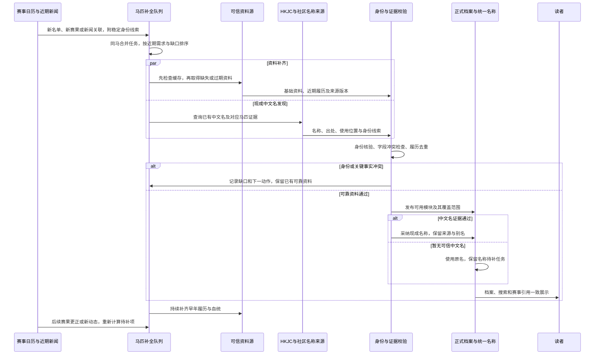

# 历史设计参考（方案建议，不覆盖spec用户要求）

## 3 赛马信息

### 3.1 用户明确的目标

| 编号 | 已确认的用户期望 | 能力含义 |
|---|---|---|
| H-01 | 近年赛马相关信息优先补足，因为读者更关心最新情况 | 补齐顺序应体现近期使用需求；既补新马，也更新既有马匹的新成绩与变化 |
| H-02 | 尽可能多地获取中文译名；没有 HKJC 官方译名时，可以使用社区公认译名 | 同时建设官方与社区名称的发现、身份核验、采纳和公开展示链路 |
| H-03 | 不能自己翻译马名 | 程序、模型和编辑均不能为填补空缺自行起名；没有可核验的现成译名就保留原文并记录缺口 |

本轮用户进一步确认：**优先近 3 年参赛马，当前赛季、即将登场和近期新闻涉及者优先；没有 HKJC 名时，认可的专业社区来源明确使用即可采用，冲突时复核。** 日期边界建议采用滚动 3 年窗口；近期重新成为新闻焦点的退役马也可进入优先队列，不按出生年份或年龄筛选。

保留历史线程中 **2020 年起全部 G1 参赛马**的中文名缺口目标，包括 Jpn1 和香港本土一级赛，排除日本地方非 Jpn1 及其他地区 Local G1；近期优先调整处理顺序，不把全部参赛马缩成胜马，也不视为取消更早历史资料。马匹范围不自动套用新闻模块的五地区边界；具体地区、目标数量和年度切片在总版本范围冻结时明确。

### 3.2 当前理论、实际、期望与 Gap

| 能力 | 当前理论状况 | 当前实际状况与证据边界 | 未来期望及主要 Gap |
|---|---|---|---|
| 补全优先级 | 已有 P0 参赛马来源、分地区队列、滚动批次；队列使用近 30 天新闻数、履历新鲜度、人工来源、重大赛事来源等信号；参赛候选抽样也使用最近赛事日期 | 尚未取得当前全站“近期应补马匹 → 可见完整资料”的覆盖与耗时账本；历史采集凭证只能说明对应阶段完成，不能证明公开档案完成 | 将即将参赛、刚取得新成绩和近期新闻关联提到业务优先级；补齐对象包含尚未建公开档案的马，不能只在已有 P0 档案内排序 |
| 基础资料、血统与履历 | `HorseProfile` 有基础信息、血统、履历同步日期、来源出赛数、缺口与完整度；有采集、外部暂存、身份绑定、模块候选及公开发布机制 | 拯救者有成绩相关新闻，档案仍显示 0 战且无履历；A Wave Of The Sea 显示 65 战、前三名均为 0，履历却出现 1/2/3。缺数据和统计矛盾均存在 | 先使近期身份、成绩和资料可用，再补完整生涯；空缺不能冒充真实 0；摘要、明细和统计使用一致资料版本 |
| 中文名来源 | `termbase_seed` 支持 HKJC、本地/海外赛事和 WPStud；已有官方优先、民间别名、繁简处理、冲突表与来源证据 | DINOZZO 档案仍显示原名及“中文译名待补”，历史要求补其 HKJC 名；已有种子能力未证明该马从来源到公开名的闭环完成 | 补齐官方来源的身份绑定和展示缺口，扩展有证据的社区译名；本轮所查服务未见 Bilibili 内容进入名称采纳的专门链路 |
| 候选与身份核验 | `TermCandidate` 支持接受、合并与别名；`TermCandidateEvidence` 绑定新闻文章；另有外部马匹、来源身份及名称变体 | 没有当前社区名称覆盖率、同名误合并率及全量名称出处审计结果 | 接入独立网页、视频或字幕定位证据；马名相同只用于找候选，采纳必须确认同一匹马；来源可信度与身份可信度分别判断 |
| 资料与名称联动 | 档案持有中文显示名快照，另有正式词条与多语言别名，新闻实体保护及赛事记录可引用名称 | 美艺力量 45 条履历已能分页展示，但有英文赛事名、等级缺失等；DINOZZO 有履历却缺中文名；各部分完整程度不同 | 名称采纳后贯通档案、搜索、赛卡、赛果及后续新闻；“已采集”“已入正式资料”“已公开”分别核验 |

实际页面证据沿用本日 18:45 起的[能力基线](../../reports/2026-10-02-current-capabilities.md)和 19:02–19:03 的[旧案例复访](../../reports/2026-10-02-backlog-evidence-reconciliation.md)，并非本节重新执行的生产全库审计。上述个案足以证明存在缺口，不能外推全站比例或唯一根因；历史暂停和批次数字也不能当作此刻进程状态。

代码入口：[P0 来源及补全队列](../../../server/stable/services/p0_horse_profiles.py)、[批次选择](../../../server/stable/services/p0_horse_completion_batch.py)、[通用补全](../../../server/stable/services/horse_profile_completion.py)、[名称种子](../../../server/stable/services/termbase_seed.py)、[候选采纳](../../../server/stable/services/term_candidate_review.py)、[档案服务](../../../server/stable/services/horse_profiles.py)、[公开发布](../../../server/stable/services/horse_profile_publish.py)、[模型](../../../server/stable/models.py)。

具体差异：当前 `build_p0_completion_queue` 先按地区、完整度、人工来源和待处理候选排序，再考虑近期新闻、重大赛事来源等；不是完全没有近期信号，但尚不等于近期需求优先。通用 `plan_profile_completion` 则按地区、ID 排序。应在既有机制上收敛统一业务优先级，避免再造一条无法对账的采集链。

### 3.3 近期优先的补齐方式

**建议将“优先补谁”和“每匹马先补什么”分开。**

| 建议层次 | 进入条件 | 优先交付的内容 |
|---|---|---|
| 当前需求 | 即将参赛、刚有确定赛果、近期重要新闻涉及；同一匹马多信号合并 | 稳定身份、可用原名/中文名、基础资料、近期赛绩、与对应赛事和新闻的链接 |
| 近年覆盖 | 在约定的近年窗口内有实际参赛记录，包括未获胜者 | 基础资料、近期履历连续性、可核验血统、中文名缺口及有效的统计范围 |
| 历史补齐 | 既定历史目标、近期马匹的早期生涯及其必要关联资料 | 完整生涯、历史中文名与别名、血统及主胜鞍归一化；保留可见进度和缺口 |

上述是建议优先顺序，不是无限抢占：为历史目标保留持续处理能力，并记录排队年龄，避免永远做不完。跨地区使用相同质量标准，记录地区等待时间和来源阻塞，防止高产地区独占任务；不要求机械等量。已有缓存应先核验复用，失效资料再更新，避免为了换排序重抓全部历史。

每匹马分步交付：

1. **身份与基本可读档案**：来源稳定 ID、原文名、已核验中文名或待补状态、出生/性别/出生地等可得字段；没有中文名不阻止可靠原名档案可用。没有唯一身份时保留候选，不能抢先合并。
2. **近期实用资料**：最近已发生比赛、名次或非完赛状态、距离、场地、级别、骑师等可信字段，关联赛果与新闻；已知退赛不记实际出赛。未取得的完赛时间等字段明确留空。
3. **完整生涯与血统**：继续补早年和跨地区履历、父母及两代血统、主胜鞍和汇总；近期记录先完成，不必等待完整生涯后才让读者使用，但须清楚标记覆盖范围。

“资料新鲜度”和“资料完整度”分别表达，例如“成绩更新至 10 月 2 日；更早履历补全中”。只有出生和血统齐全不能宣称赛绩完整；已完成生涯回填也可能因新比赛变得过时。当前列表默认排序与后台补齐优先级是两个独立决定，本轮不由“近期优先补足”自动推导列表改版。

### 3.4 中文名来源与采纳规则

**复用已有 HKJC 优先的基础，向可核验社区使用扩展。**

| 来源或情况 | 建议处理 |
|---|---|
| HKJC 已明确使用，且对应同一匹马 | 作为主显示名的优先来源；保留官方原始繁体写法与经校验的简体展示写法 |
| 无 HKJC 名，但认可的专业社区来源明确使用 | 按用户确认口径，身份和证据通过即可采纳；标明社区来源，不强制等待第二个独立来源 |
| 多个可信来源使用不同中文名 | 先查是否同名异马、旧名或误配，再比较来源与使用情况；不能仅按搜索数量、多数转载或模型偏好决定 |
| 戏称、简称、临时梗、低可信评论 | 可以留作检索线索；没有稳定使用和明确身份证据时不作主显示名 |
| 只有外文名，或来源无法核验 | 保留原名和待补原因；不通过音译、意译、模型记忆或“看起来合理”补造中文名 |

“认可来源”建议按作者/网站的历史准确性、马匹对应信息、稳定用名和纠错情况校准；平台知名度、播放量不直接等于名称可靠。Bilibili 是可能的证据载体，并不意味着全平台译名一律可信。本轮不凭空指定博主名单，也未执行新增社区抓取。

来源证据至少记录：中文原文、对应外文名、发布者、页面地址或 BVID、发布时间、采集时间、原文位置/视频时间点、支持同一马匹的身份依据及采纳理由。尽可能保存可复核的最小证据。网页标题、简介、字幕和视频画面可作为不同位置，来源之间的转载关系也要保存，不能把同一译名的转载当作独立共识。

模型可检索线索、定位视频中的现成中文写法、整理候选和发现冲突；OCR/语音识别仅帮助定位与提取，必须回查原始证据。仅听到外文读音不能由模型拼出一个中文译名；只有模型输出、却没有可核验中文出处的候选不能采纳。繁简转换属于字形规范化，需保存原文并检查歧义，不得借此改写含义。

**名称证据和身份事实分开。** 社区视频能证明“作者用过这个中文名”，不因此成为该马出生、血统或成绩的权威来源。先依靠来源 ID、出生年份、性别、父母及赛事参与信息确认身份；名称相似只用于召回。一个马号只在当场有意义，不能当全局马匹 ID。

同一匹马保留一个当前主显示名及多个有出处的别名。以后找到 HKJC 名时，建议在身份一致且无未决冲突的前提下更新主名，旧社区名继续可搜索；保留名称变更记录。不能在存在身份冲突时把另一个中文名直接塞进别名，导致两个实体被静默合并。

### 3.5 从近期需求到公开档案的时序

这是未来设计，不表示来源调用或自动发布已经启用。任务沿用既有身份、采集和模块发布机制；分别记录“发现、取得证据、身份通过、正式资料更新、公开可见”的结果。名称未补不能阻断已核验近期赛绩，完整生涯未齐也不能把可用近期资料全部扣住。

### 3.6 与新闻、赛事及既有缺陷的衔接

- **新闻模块**：识别出可信马匹身份后触发资料缺口任务；翻译使用已采纳名称，没有中文名时保护原文。不得为了减少未知词条而自行创造马名。已有新闻的批量改名或事实回写单独界定范围，不能全库字符串替换。
- **赛事模块**：确定名单带来赛前补全任务，已确认赛果及更正更新马匹近期履历。待确认结果与正式生涯统计区分；取消、未出赛和非完赛遵循模块 2 的状态语义，重复到达不得重复增加出赛次数。
- **统一展示**：名称采纳后检查词条、档案中文快照、别名搜索、赛卡和赛果引用；防止词库已更新但档案仍用旧快照。已有手工锁和冲突需可见处理，不能静默覆盖。
- **统计一致性**：同一确定结果版本应驱动相关汇总；不完整履历只能标为“已收录 N 场”，有可信总出赛数时分别显示总数与已收录数。空缺不是 0 胜，缺历史时不计算伪完整的胜率。
- **历史问题**：DINOZZO 名称、拯救者履历、A Wave Of The Sea 统计矛盾和美艺力量主胜鞍等级作为回归样例。美艺力量 45 条分页已显示，不再把旧“只有 17 条”的具体问题当成当前缺陷。

赛事的 5/10 分钟资料替换时限是已确认的模块 2 目标；本轮尚未把同样 SLA 承诺到整匹马的完整生涯补齐。应分别定义近期结果投影、新档案可用、中文名发现和历史回填时效，避免一次缓慢的名称搜索拖住赛事公开结果。

### 3.7 验收与差距台账

建议先建立目标账本，再用相同分母观察以下指标。目标来自约定的赛事/参赛名单与近期新闻实体，不能只数数据库里已经存在的公开档案；同一匹马跨地区参赛要去重，身份待定项另列且不得从缺口中消失。

| 指标 | 建议口径 |
|---|---|
| 近期可用档案覆盖 | 目标马匹中，身份已核验、最低可用资料达到约定且公开可见的比例；同时报告尚无档案、身份待定和关键字段缺失 |
| 最新赛绩同步 | 可信已确认赛果中，应关联马匹履历的记录是否已公开；测量从结果可用到档案可见的时延与超时数 |
| 中文名覆盖 | 目标去重马匹中，已有可信中文名且公开展示的比例；分 HKJC、社区、无现成名称、待核验、冲突统计 |
| 名称出处完整性 | 新采纳马名均能回到现成中文出处和唯一马匹身份；这是硬性验收，不用“有中文字符”替代 |
| 有名未用的处理率 | 已找到可信译名的目标中，完成采纳及各页面同步的比例；与“来源本来就没有译名”分开 |
| 生涯完整与统计一致 | 按马核对来源总出赛、已收录、去重、非完赛状态、缺口和统计；抽查近期与跨地区样本 |

中文名总覆盖率不能预先承诺 100%，因为外部可能不存在现成译名；不自行翻译是明确约束，不能为达覆盖数字降低证据标准。具体近期覆盖目标、日处理量和时限需在目标 census 与来源盘点后定值。

| Gap ID | 需要交付的结果 | 当前可复用 | 主要差距 |
|---|---|---|---|
| HG-01 | 近期马匹目标、缺口与优先级账本 | P0 参赛来源、新闻关联、队列及批次 | 明确近年窗口、纳入未建档对象；近期任务不再被旧空档案长期挤压 |
| HG-02 | 基础资料和近期履历分步可用 | 外部资料、身份绑定、模块候选、发布服务 | 从已有缓存到正式公开的链路闭合；近期覆盖与完整生涯分开表达 |
| HG-03 | HKJC 名称补齐与档案同步 | HKJC 种子、繁简规则、词条及别名 | 找到名称后身份绑定、采纳、快照和页面引用仍有缺口 |
| HG-04 | 有出处的社区译名发现与采纳 | WPStud、候选及来源证据 | 扩展社区来源和视频定位证据，确定采纳标准、冲突与无名处理 |
| HG-05 | 统一名称、身份与更名追踪 | 正式词条、多语言别名、外部稳定 ID | 所有入口显示/搜索一致，阻止同名异马及无出处自造名 |
| HG-06 | 新赛果持续更新及统计纠错 | 赛事版本、履历去重、完整性评估 | 更正向档案传播，未知与 0 分开；收敛主胜鞍和汇总矛盾 |
| HG-07 | 分地区覆盖报表与固定回归集 | 现有运行产物、页面样例 | 用公开可见结果衡量进度，不把已抓取、暂存或处理完成当交付 |

建议实施依赖：先完成 HG-01 的目标账本和身份缺口盘点，再打通 HG-02/03 的近期资料及官方名称；HG-04/05 复用同一身份底座，HG-06 与赛事版本链衔接，最后用 HG-07 验收。排序方案与名称政策可先设计，不必等待全部历史采集完成。

### 3.8 已确定与待确定

**已确定**：优先近 3 年参赛马，当前赛季、即将登场和近期新闻涉及者优先；尽可能使用 HKJC 官方或社区已有中文名；认可专业来源明确使用且身份可核验时可采纳，冲突时复核；不自行翻译马名；历史“2020 年起 G1 全部参赛马”缺口目标继续保留。

**设计建议**：时间边界采用滚动 3 年；近期最低可用资料先交付，完整生涯持续补齐；资料新鲜度、完整度和中文名可用性分别表达；名称变更保留旧别名，各入口引用同一实体和名称决定。

**后续需要证据盘点**：认可社区作者/网站及其样本、各地区目标数量、现有缓存可复用比例、公开名称和履历覆盖率、处理能力与时限。具体名单、批量范围、来源访问方式和排期尚未冻结；没有恢复历史采集、调用付费接口或修改生产数据。
