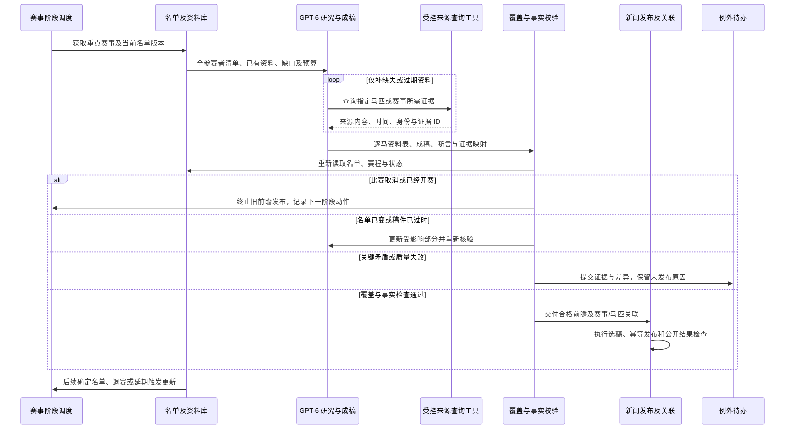

# 历史设计参考（方案建议，不覆盖spec用户要求）

## 8 GPT-6 复杂任务自动化

### 8.1 已确认方向与能力基线

用户希望用 GPT-6 API 自动处理硬规则难以覆盖的复杂任务，明确包括专有名词判断与保护、多源赛前/赛后资料获取及汇总，以及覆盖全部参赛者的多源赛前前瞻。用户已在 ChatGPT 定时任务中尝试前瞻并反馈效果好；本轮未读取其提示词和成稿，不把该经验当作项目 API 接入或生产稳定性的证明。

本轮进一步确认：**自动前瞻先覆盖重点赛事，验证质量和成本后再扩展。每场核对完整参赛名单，逐匹收集信息，缺资料明确说明。** 重点赛事具体集合、首次出稿时间和更新频率尚待统一定义。

| 能力 | 当前理论状况 | 当前实际证据与 Gap |
|---|---|---|
| 模型翻译和改写 | 已有 OpenAI-compatible/SiliconFlow provider、模型配置、占位保护、单篇改写及运行记录 | 本轮代码中两类 provider 均使用 `client.chat.completions.create` 与 JSON object 模式；未见本轮目标的多源自主查询、严格结构输出及全参赛者前瞻链 |
| 来源与数据获取 | 已有抓取适配器、赛事来源、TRA、马匹资料及内部身份库 | 可包装为查询工具复用，但模型任务如何选择下一来源、保留证据、处理冲突和停止尚需实现 |
| 自动内容发布 | 已有校验、选稿、发布窗口和人工兜底 | 需要新增综合稿类型、来源到断言映射、名单版本与更正联动；不是把模型输出直接当作可发布稿 |
| 质量与运行治理 | 已有日志、重试和部分规则回归 | 缺少针对模型判断的黄金样例、事实/覆盖评测、任务预算、时延和失败降级证据 |

代码入口：[翻译](../../../server/stable/services/translation.py)、[单篇改写](../../../server/stable/services/rewriting.py)、[实体解析](../../../server/stable/services/terms.py)、[资料来源](../../../server/stable/services/race_data_sync_providers.py)、[发布决策](../../../server/stable/services/automation.py)。

### 8.2 官方 API 能力核对与模型选择边界

2026-10-02 查阅并打开官方文档后，已核实 `gpt-6-astra` 支持函数调用、结构化输出，以及 Responses API 下的 Web Search 等工具；可作为用户指定 GPT-6 方向的首轮复杂任务评测候选。具体账号可用性、预算和最终参数尚未实测，不把当前聊天环境中的模型可用性当作项目 API 账号权限。[GPT-6 Astra 官方模型页](https://developers.openai.com/api/docs/models/gpt-6-astra)

官方 Function Calling 文档明确 GPT-6 Astra 的工具调用使用 Responses API。因此建议为复杂任务新增 Responses 调用适配，保留现有翻译通道进行对照；仅替换旧 `TRANSLATION_MODEL` 配置不足以实现自动多源研究。[官方工具调用说明](https://developers.openai.com/api/docs/guides/function-calling)

Structured Outputs 可约束输出结构，但仍可能产生内容错误。所有事实、实体、名单覆盖与公开变更仍需业务校验；模型自报置信度不能替代实测正确率。[官方结构化输出说明](https://developers.openai.com/api/docs/guides/structured-outputs)

默认先将既有来源适配器和内部查询包装为受控工具。内置 Web Search 可作为单独评测的补充来源发现方式；其官方文档要求对终端用户展示搜索结果或其中信息时提供可点击引用，与现有普通新闻隐藏来源的口径需要专门协调。因此不默认把内置搜索输出直接接入隐藏引用的公开自动成稿路径；若采用该路径，应先明确综合稿的引用展示合同。[官方 Web Search 说明](https://developers.openai.com/api/docs/guides/tools-web-search)

### 8.3 适合模型判断的任务清单

下表是任务候选及建议顺序；模型的判断输出经证据与业务规则验证后可自动执行，只有异常进入人工队列，并非每次模型调用都等待人批准。

| 任务 | 模型负责的复杂判断 | 程序负责的执行和验证 | 建议顺序 |
|---|---|---|---|
| 专名识别与锁定 | 判断上下文中的词是马名、人名、赛事还是普通词，发现漏识别实体 | 校验原文片段、身份和现成译名，执行占位保护及恢复；不得自译马名 | 首批，与 NG-03 共用 |
| 多源资料研究 | 根据赛事阶段和已有缺口决定查什么来源，读懂非标准页面中的资料 | 提供有权限且有预算的读取工具，保存原始证据；结构化 API 已明确的字段直接解析 | 首批，先只读证据整理 |
| 冲突与变化解释 | 区分旧报道、最新更正、预测、确定消息和真正冲突，解释差异 | 按来源能力、版本、名单完整性和生效规则决定是否更新；转载不算独立证据 | 首批，与 RG-02/04 共用 |
| 全参赛者赛前前瞻 | 跨语言汇总每匹马的近况、赛绩、适性、采访与不确定点，形成有层次的文章 | 冻结名单版本，逐匹对账、断言溯源、时效检查及赛前再校验 | 首批重点产品能力 |
| 赛后综合报道 | 把完整赛果、可信赛程报道及采访组织成赛果报告和后续影响 | 校验名次、非完赛、退赛和更正；只有结果表时不得虚构比赛过程或引语 | 前瞻基础稳定后 |
| 新闻重要性与新增事实 | 判断是否值得单独发、与已有稿件是否同一事件、有什么真正增量 | 执行五地区周覆盖、预算、去重及发布窗口；保留重要事件漏报检查 | 与 NG-05 共用评测 |
| 正文污染和完整性判断 | 分辨广告、导航、相关推荐与正文，识别错误截断或重要段落误删 | 按来源 DOM 和模型给出的区块 ID 清洗，检查原文完整性，保留差异 | 与 NG-02 共用 |
| 翻译事实审校 | 检查否定、计划/已发生、引语归属及复杂句意，定位事实漂移 | 对姓名、日期、距离、奖金、名次执行确定性校验，有限重试或保留原文 | 与 NG-04 共用 |
| 现成中文名搜集 | 在认可来源中找已有中文名，匹配外文名和使用语境，发现冲突 | 核验同马身份、来源原文和位置；字形规范化；没有出处保留原名 | 与 HG-04/05 共用 |
| 新闻关联与重点分类 | 区分赛事届次、主角/背景提及、前瞻/结果报告/采访，建立候选关系 | 写入既有关系模型、检查公开权限与双向一致性，保留移除和更正 | 与 LG-01/04 共用 |
| 新闻事实触发资料变化 | 从报道中识别“计划参赛”“确定退赛”“比赛取消”等事实及时间语义 | 形成带出处的资料候选，交给模块 2/3 的统一更新规则；计划不能变成确定 | 资料更新合同稳定后 |
| 后台异常归因与建议 | 汇总运行证据，判断可能是正文模板变化、身份歧义、来源停更或重复问题 | 自动执行已有且适用的恢复动作；新规则或高影响操作不由模型自由执行 | 后续增强，先给建议 |

Model 输出需支持“证据不足”“存在冲突”“需要再查询”，不能强迫每项给肯定答案。置信阈值依据各地区与语言的标注样例校准，不采用模型自报 95 分就等于 95% 正确的口径。

### 8.4 共用的自动任务执行方式

建议沿用 Celery 定时/事件触发，由应用构造任务上下文：任务类型、赛事/马匹/文章 ID、截止时间、当前资料版本、来源范围和预算。模型可在限定范围内调用读取工具，自主补充证据和调整查询；多轮调用由任务执行器持久化和恢复。

建议的工具职责包括：读取本场最新名单与状态、查询马匹身份和现成名称、检索已收录相关新闻、读取可信来源的证据、查询缺口以及返回带证据的候选结果。API 凭证由服务器持有，工具按对象和来源校验参数，不把数据库任意写入、直接公开发布或修改来源权限暴露为自由工具。模型可以提出结果和下一步，程序按既定规则自动落地合格内容。

优先读取已取得且仍有效的资料，再获取真实缺失信息。来源页面和文章仅作为数据，不执行其中夹带的操作指令；URL、实体 ID 和事实引用必须对应真实取得的证据，不能接收模型虚构的链接或不存在的工具结果。

输出至少包含：目标身份、输入版本、事实/实体候选、逐条证据引用、来源时间和读取时间、冲突/缺失、建议动作及退出原因。程序验证结构、证据存在、实体一致、数值和时间关系、是否晚于输入版本，以及任务完成条件。合格候选自动进入原有发布或资料更新链，失败只阻断受影响对象。

每次运行记录模型 ID、提示词/Schema 版本、输入摘要、工具调用、证据集合、耗时、用量、重试和公开结果关联。按同一任务目标与输入版本去重，网络重试不能重复发布文章或累加赛绩。多个前瞻生成请求共用版本锁，临近开赛的陈旧生成结果不得覆盖更新稿。

### 8.5 重点赛事前瞻的完整产品流程

**输入与覆盖。** 以具体赛事实例和当前可信参赛名单为锚点，记录这是预想名单还是确定名单及其版本。按每匹马建立资料格：现成中文/原名、近期赛绩、距离/场地经验、近期训练或采访、骑师/练马师变化、退赛信息、证据时间与缺口。已有统计直接读取并核验，不让模型重新猜算。

“覆盖全部参赛者”首先意味着每个当前名单中的身份都有一项处理结果，且发布前没有漏掉或多写参赛者；资料不足可明确写暂无可靠近况，不能为了每匹马篇幅相同而编造。确定名单尚未公布时只产出明确标注的预想版，正式名单到达后更新；退赛马可转入变更说明，不继续作为确定参赛者分析。

**成稿结构建议。** 比赛基本信息与版本时间 → 本届主要看点 → 全部参赛者逐匹情况 → 有依据的对比与不确定因素 → 名单/信息变更说明。事实、引用和分析判断分开；没有来源支撑的训练、伤情、战术和采访不得生成。是否需要具体赛况预测及其表达风格可沿用用户满意的样稿再定，不自动扩成投注推荐产品。

**质量校验。** 发布前按最新名单重新核对马匹 ID、人数、退赛、比赛时间与状态；赛事已取消、开赛或输入关键版本过时时停止发布旧前瞻并重新决定下一动作。句段中的关键断言映射到证据，模型审校与程序不变量共同检查；另一轮模型说“通过”不等于独立事实证明。

**发布与更新。** 建议同场维持一篇可更新主前瞻，关联该场及其中各马，进入模块 1 的选稿/重复控制和模块 6 的重点新闻排序；确认名单、重要退赛、延期等触发有界增量更新并显示更新时间。同类变化不每次都新发一篇文章，赛后另产明确的赛果报告，不悄悄把旧前瞻改写成赛后文章。

**时间设计。** 采用先研究、后补差、发布前轻量复验的方式，避免所有查询都挤到开赛前。初稿和更新的精确时间、重点赛事集合、信息观察窗口及单场预算仍需结合样例与测量确定；不从 ChatGPT 定时任务的成功经验直接推导 API 的固定耗时和成本。

### 8.6 时效、成本与失败行为

常规 10 分钟、重点 5 分钟的确定资料替换目标继续有效。已经有可靠结构化资料且规则足够的更新直接执行，不能为了等待长篇研究而错过公开更新期限；模型用于尚需理解或补证的部分，前瞻写作和即时结果更新分开排队与预算。

设置单任务最长时间、工具调用与 token 预算、来源请求上限和有界重试，临近业务截止优先完成关键资料；耗尽预算时输出已证实内容、缺口和状态，不猜测成功。缓存键包含实体身份、源内容版本和时效，退赛/更正到达时使相关旧结论失效；缓存不是永久事实。

先比较规则基线、现有翻译链和 GPT-6 增强链的质量、延迟与单位合格产出成本，再决定哪些稿件全量调用、哪些只在歧义或冲突时升级。相同的实体与证据判断在清洗、翻译、关联、前瞻之间复用，避免一篇新闻重复研究多次。模型不可用时，已有可靠结构化链路继续，依赖模型才能确定的内容进入有界等待或例外处理。

### 8.7 评测和交付拆分

把用户满意的 ChatGPT 前瞻提示词与成稿作为后续样式/质量样例，再加入相同赛事的完整名单和来源快照用于客观评测；本轮尚未取得这些材料。测试集覆盖日/港/英/法/美及计划采用的其他赛事地区，包含普通词马名、同名异马、跨年赛事、无中文名、转载、过期消息、来源冲突、临时退赛、取消、并列、非完赛和查询失败。

| 评测维度 | 验收内容 |
|---|---|
| 实体判断 | 精确率与召回率、普通词误识别、身份错配、现成名来源及占位恢复 |
| 多源事实 | 关键断言证据覆盖、冲突漏检、过期信息采纳、引用是否实际支持结论 |
| 前瞻覆盖 | 当前名单逐匹处理、遗漏/额外马匹、未知明确表达、发布前名单版本一致 |
| 内容质量 | 事实与分析分离、关键信息遗漏、重复冗余、阅读结构；与用户认可样例对照 |
| 运行与成本 | 任务成功/退出原因、端到端耗时分布、工具和 token 用量、每篇合格稿及每场研究成本 |
| 系统效果 | 是否减少人工介入、提高近期资料/关联覆盖，同时保持模块 1–3 的质量与时效 |

首批评测采用固定输入的离线回放与只产候选的运行对照，再按既定项目流程启用具体自动化范围。无需让每条正常结果永远人工批准，也不能只凭一篇好稿便把所有复杂任务同时切换。

| Gap ID | 需要交付的结果 | 与既有模块的关系 |
|---|---|---|
| AG-01 | GPT-6 Responses 适配、结构输出与任务运行记录 | 共用执行基础；实际模型和账号能力核验 |
| AG-02 | 内部资料和来源的受控查询工具、证据账本 | 复用 RG/HG 资料链，不重建来源体系 |
| AG-03 | 专名、正文、翻译、重要性与关联判断评测接入 | 对应 NG-02–05、HG-04/05、LG-01/04，只估一次业务工作量 |
| AG-04 | 多源赛前/赛后研究与冲突候选 | 对应 RG-02/04/06；时效与成熟度仍按模块 2 |
| AG-05 | 重点赛事全参赛者前瞻、发布前复验及增量更新 | 本轮明确的新综合稿产品能力 |
| AG-06 | 赛后综合报道与新闻事实变更候选 | 复用前瞻证据、赛事版本与资料更新合同 |
| AG-07 | 黄金样例、对照评测及质量/成本/时延观测 | 与 NG-07、RG-07、EG-06 共用证据 |
| AG-08 | 预算、缓存、幂等、版本失效、恢复与降级 | 与统一任务/后台例外链路集成 |

### 8.8 已确定与待细化

**已确定**：GPT-6 API 可作为复杂自动任务的目标方向；专名判断和保护、多源赛前/赛后信息研究及全参赛者前瞻进入设计；前瞻先覆盖重点赛事，再按质量和成本扩展。模型仍不得自行翻译马名。

**设计建议**：优先评测 `gpt-6-astra` 和 Responses 工具调用；模型负责语义理解、研究、组织与候选，程序负责证据校验和符合既定规则的自动执行；保留现有 Django/Celery 主干。

**待细化**：重点赛事集合、前瞻出稿时间和风格样例、模型账号及预算、每任务调用边界、综合稿引用展示及最终评测阈值。本轮只核对文档和代码，没有调用付费模型、创建定时任务、部署代理或开启新的自动发布。
