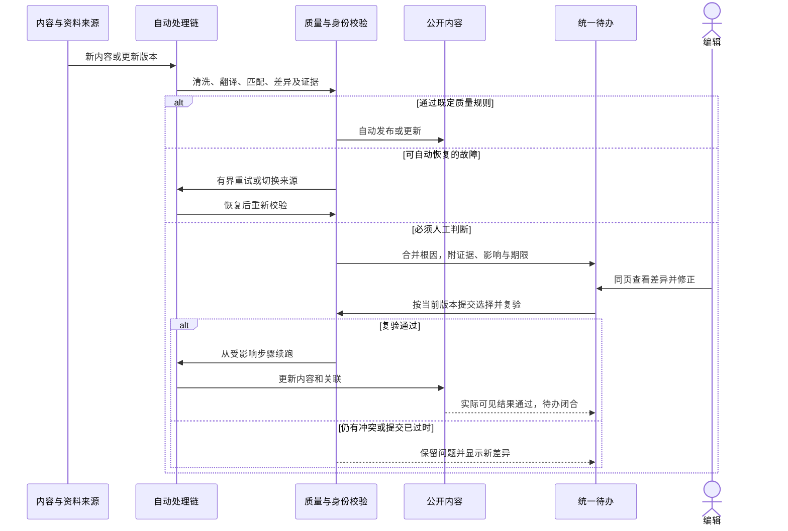

# 历史设计参考（方案建议，不覆盖spec用户要求）

## 5 编辑后台

### 5.1 已确认目标与当前差距

用户希望重构后台，同时达到两点：人类使用更友好、减少不必要流程；弱化后台在全流程中的重要性，大部分内容更新走自动链路，仅必要时人工审核。

| 能力 | 当前理论状况 | 当前实际状况与边界 | 未来期望及 Gap |
|---|---|---|---|
| 编辑效率 | 已有保存/自动保存、预览、快速术语、审核并发布、驳回与撤回；不是所有稿件必须逐步提交后再单独发布 | 本日只实访后台登录入口，未完成真实编辑任务计时；交互不友好是用户提出的改进目标 | 按人的任务组织界面，减少跨页面找上下文、重复填写和无意义确认；需用真实任务验证 |
| 自动处理 | 新闻评分、审核模式、自动发布、失败重试、赛事和马匹更新均有底座 | 代码有自动通道不等于大部分生产更新已无需人工；没有当前自动完成率、人工介入率与耗时基线 | 正常且通过质量校验的更新自动完成，后台处理例外与纠错 |
| 异常工作台 | 存在新闻池、术语候选、赛事候选、马匹审核、地区生产和覆盖看板，部分在 Django Admin | 导航与入口按对象/技术环节分散；尚未形成统一、按业务影响排序的人工待办 | 聚合同一根因，给出证据、影响、建议动作和下一期限；减少编辑自行查日志 |
| 人工保护 | 有人工字段标记、手工关联保护、候选与操作日志 | 新闻表单保存会标记一组编辑字段为人工维护；是否仅必要字段受保护、长期是否阻塞自动更新需要专项核验 | 精确保护实际修改字段，保留版本与撤销方式，让后续无冲突更新继续推进 |
| 移动操作 | 有折叠菜单和响应式样式，历史需求明确手机快速处理 | 尚未验证手机上的完整运营路径 | 手机能完成异常处理、名称采纳、修稿发布及撤回；桌面支持高效对照与批量处理 |

代码证据：[后台导航](../../../server/stable/templates/stable/console/base.html)、[文章编辑器](../../../server/stable/templates/stable/console/article_editor.html)、[后台路由](../../../server/stable/urls.py)、[视图与表单处理](../../../server/stable/views.py)、[自动化决策](../../../server/stable/services/automation.py)。

本次重构建议主要改变交互和任务编排，复用现有 Django/Celery、身份、证据及更新机制。没有证据要求更换前端框架或业务服务架构；具体 UI 原型与工程方案在版本范围明确后制作。

### 5.2 后台围绕人的任务重新组织

建议保留四个日常工作入口，底层日志和管理工具作为展开项：

| 入口 | 人主要做什么 | 默认呈现 |
|---|---|---|
| 待处理 | 解决确实需要判断的异常 | 业务影响、超期程度、受影响对象、证据、建议动作；同一根因合并 |
| 内容 | 找到新闻并编辑、预览、发布或撤回 | 公开效果、原文/译文差异、实体标签和关键检查结果；常规自动稿可抽查 |
| 资料 | 处理赛事、马匹、译名和身份冲突 | 当前资料、候选差异、来源及关联影响；在同页完成核验 |
| 自动化 | 看系统是否正常及调整既定策略 | 分地区覆盖、质量、最新成功、下一动作、积压；内部任务与日志按需展开 |

首页首先回答“现在需不需要我处理、哪件最重要”，无需编辑打开多个列表汇总。系统暂时等待来源、正在正常重试和需要人判断应有不同状态；不是每条技术失败都变成审核任务，也不能用空待办列表掩盖自动链路停摆。

单个待办在一页内呈现“问题 → 证据/差异 → 建议选择 → 影响 → 执行结果”。支持在原位补术语、修改错误关联、查看预览和继续下一项；技术 ID、调度代次等默认收起。批量操作只聚合同类型、同处置意图的对象，执行前显示范围，结果逐项可见，不用一键全部通过处理混杂身份冲突。

### 5.3 自动处理与人工介入的分工

以下是建议规则，实施时与模块 1–3 的质量合同一起落地，而不是单纯降低审核阈值。

| 场景 | 默认处理 | 需要人时提供的内容 |
|---|---|---|
| 来源和正文可靠、翻译及事实校验通过的入选新闻 | 自动发布并更新关联 | 可抽查结果；不要求例行点击批准 |
| 身份明确、可信确定资料到达的赛事/马匹更新 | 按既定来源和版本规则自动更新 | 正常变化不逐条人工审核；异常变化才显示差异 |
| 已认可来源的现成中文名，身份一致且无冲突 | 按模块 3 采纳规则自动处理 | 新来源可信度或身份有歧义时进入例外处理 |
| 超时、短暂网络错误、任务中断 | 有界重试、备用来源和幂等恢复 | 多次恢复失败或临近业务截止时显示影响与可执行下一步 |
| 同名异马、赛事届次不明、关键事实矛盾、正文质量失败 | 阻断受影响内容或字段，保留已有可靠版本 | 原始证据、冲突字段、候选方案；不能以人工按钮掩盖质量校验失败 |
| 来源尚未公布确定资料 | 自动跟踪下一次检查与阶段期限 | 到期仍缺资料时说明来源等待与恢复路径；不得自动制造确定结果 |

业务上的人工审核与工程发布授权是不同事项，工程交付仍引用根 `AGENTS.md`；本设计没有启用自动发布或扩大现行生产自动化范围。

### 5.4 人工解决例外后自动续跑

常规路径不能依赖有人打开后台页面才触发。一次人工修复应触发相关内容的有界重处理，不要求人再手动寻找所有受影响稿件；词条修复、实体合并等大影响动作要明确范围与结果。

编辑与自动任务并发时校验版本，过时表单不能覆盖刚到达的新赛果；保留修改差异、字段保护和操作记录。优先保护实际改过的字段，而不是一次保存后整篇长期停止更新。撤回、解除保护和关联更正应有明确操作语义；不承诺所有动作都可以无损一键撤销。

### 5.5 验收与交付拆分

先测量当前基线，再定具体改善幅度。人工操作基线覆盖修正译名、处理错误赛事关联、修稿发布、处理赛事冲突及撤回五类任务，手机和电脑分别测量完成时间、页面切换、重复输入及失败恢复。当前没有足够证据填写“降低 50%”等数值。

自动完成率按合格业务对象/更新版本计算，不按轮询次数放大：无需人工决策且完成公开更新的数量，与全部应处理目标对账。另列无需发布、自动恢复中、来源等待、人工介入、失败和超期；不能通过排除失败对象或降低选稿质量提高自动化比例。人工介入率、队列年龄、反复打开次数、已发布质量与每日人工耗时一起验收。

| Gap ID | 交付结果 | 依赖 |
|---|---|---|
| EG-01 | 高频任务基线、信息架构和交互原型 | 真实后台任务观察；现有权限与入口盘点 |
| EG-02 | 自动/恢复/人工三类决策及统一异常原因 | 新闻、赛事、马匹质量规则 |
| EG-03 | 统一待办、影响优先级与根因聚合 | EG-02、覆盖账本与业务截止时间 |
| EG-04 | 原位编辑、差异核验、预览和移动端关键路径 | EG-01、EG-03 |
| EG-05 | 人工修复后续跑、字段保护、并发版本与审计 | 现有任务链、版本与写入规则 |
| EG-06 | 自动完成率、人工耗时和公开质量的联合验收 | 全流程真实样本及自然运行周期 |

界面原型可先推进；降低人工介入依赖上游质量和自动恢复能力，不能只靠重新布局按钮实现。自动化比例、操作时长目标、具体导航与批量处理边界仍是待基线校准的设计项。
