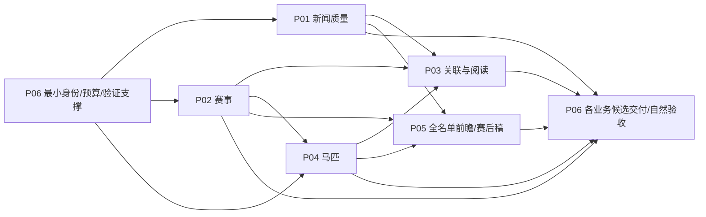

# 业务优先级与依赖建议

排序是2026-10-26交接建议，由用户决定新排期。价值分/解锁分/风险分是产品判断，不是测量数据或人天承诺；不按百分比高低排序，不因沉没token成本优先造更多机制。

| 顺序 | 项目 | 建议级别 | 直接业务收益 | 必要依赖与可先做的部分 |
|---|---|---|---|---|
| 1 | P01 新闻质量与五地区覆盖 | P0 | 减少读者直接遇到的污染/误译/漏报，改善内容供给 | 最小模型工具/实体接口；已有缓存正文可先闭环，不等完整F02/模型平台 |
| 2 | P02 可信赛事自动更新 | P0 | 减少错误与卡顿、满足<1%/<3%及5/10分钟 | 所选地区来源资格、最小版本/时间合同；地区可独立推进，发布前接公开探针 |
| 3 | P03 互联与公开体验 | P1；独立页面修复可前置 | 少跳转/找不到对象/状态看不懂，能直接浏览完整路径 | 独立U卡可先做；关系需N03实体，履历跳转需H03；Q03只合同不开放 |
| 4 | P04 近期马匹与中文名 | P1 | 最新马匹优先可读，现成中文名可查，保留独立生涯 | H01/H02及可公开的真实来源；H08等结果合同，早期档案无需等所有赛事源 |
| 5 | P05 研究/前瞻/赛后稿 | P2；M01–03按需抽小片 | 在内容/数据可信后产生新高价值内容 | 依名单、身份、合法证据、成本评测；共用工具先服务P01，不先造完整agent框架 |
| 支持 | P06 可靠性/恢复/交付 | P0仅最小支撑；完整发布在业务候选之后 | 防止已完成业务无法安全交付或恢复 | F01最小字段/预算、相关测试为先决；V/O完整验收是业务输出，不能全量挂在开发前 |
| 暂停 | P07 后台/QQ | 不自动恢复 | 需求保留，当前用户明确延后 | 只在用户重新选择后排期；已有80%下线候选不代表已启用 |

## 不再沿用的机械阻塞

- 原V02/V03是整体验收汇总；R10/N05/L04等单卡不应一律等全部后台/地区/恢复完成才开发。原deps全部保留在cards.json，但执行时以实际字段/事务/接口合同为直接依赖，集成验收阶段仍对账。
- E02/E03/E06/E07/F04/Q01/Q02暂停，不作为保留业务的硬前置。M10可交现有入口结构化报告；U04不借QQ下线改行为，U05只验保留公开站体验。
- E01/E04/E05共用核心保留，其后台交互段后置。它们没有凭拆分变成整卡完成，百分比保持0。
- F02黄金样例、F03来源、H01目标、F06容量需渐补。没有真实输入就不报真实验收，但确定性源码、复用缓存、独立页面和不冲突准备可继续。
- B286/PG资格仅挡直接依赖它的执行面，不是所有新闻/页面源实现总开关；下次直接PG前仍必须审查该修复，stopcap不变。

P06拆成前置最小支撑与后置验收，图中不是环依赖。每个业务可有独立交付候选，不承诺所有100卡同次上线。旧10/30目标保留事实；重排日期由用户确定，不能缩七天/48小时观察窗来追认准时。
